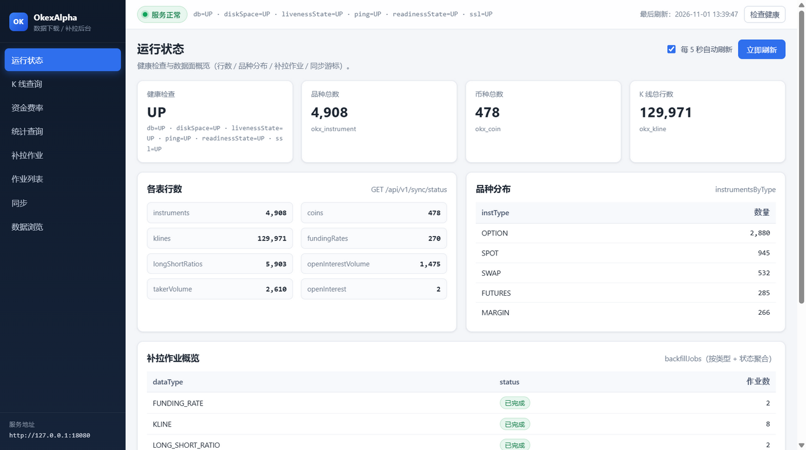

# OkexAlpha

从 OKX 公有 REST 接口下载并补拉市场基础数据、落到本地 PostgreSQL 的自托管 WebAPI 服务。
所有上游接口均为公有 GET 端点，**不需要 OKX API Key**；服务不持有任何交易凭证，也不提供下单能力。

## 功能

| 能力 | 数据来源 | 落库表 |
| --- | --- | --- |
| 平台币种清单（由品种表派生重建） | — | `okx_coin` |
| 交易品种清单（SPOT / MARGIN / SWAP / FUTURES / OPTION） | `/api/v5/public/instruments` | `okx_instrument` |
| K 线：仅永续合约（SWAP）的 CANDLE / MARK × 24 个 bar 周期 | `/api/v5/market/history-candles`、`/market/history-mark-price-candles` | `okx_kline` |
| 资金费率（当前值 + 历史） | `/api/v5/public/funding-rate(-history)` | `okx_funding_rate` |
| 多空比与精英持仓（4 类） | `/api/v5/rubik/stat/contracts/*` | `okx_long_short_ratio` |
| 合约持仓量与成交量 | `/api/v5/rubik/stat/contracts/open-interest-volume` | `okx_open_interest_volume` |
| 主动买入/卖出量 | `/api/v5/rubik/stat/taker-volume(-contract)` | `okx_taker_volume` |
| 持仓量快照（仅当前值） | `/api/v5/public/open-interest` | `okx_open_interest` |
| 补拉作业编排（规划 → 落库 → 异步执行 → 断点续跑） | — | `okx_backfill_job` / `okx_backfill_task` |
| 上游调用审计 | — | `okx_api_call_log` |
| 后台管理页面（状态 / K 线 / 费率 / 统计 / 补拉 / 作业 / 同步 / 数据浏览） | 本服务自身 API | 无（纯前端，不落表） |

## 技术栈

| 组件 | 版本 / 说明 |
| --- | --- |
| Java | 源码与字节码目标 21（`backend/pom.xml` 中 `java.version=21`），运行环境为 JDK 25 |
| Spring Boot | 4.1.2（`spring-boot-starter-webmvc`、`-jdbc`、`-validation`、`-actuator`） |
| 数据库 | PostgreSQL 18（用到 `jsonb`、`text[]`、GIN、BRIN、`ON CONFLICT`） |
| HTTP 客户端 | JDK `java.net.http.HttpClient`，无第三方 HTTP 依赖 |
| JSON | Jackson（Spring Boot 4 使用 `tools.jackson` 坐标） |
| 构建 | Maven 3.9.16（`scripts/mvn.ps1` 缺省时自动下载到 `.tools/`） |
| 服务 | 端口 18080，`server.shutdown=graceful` |
| 管理页面 | 纯静态 HTML/CSS/JS，无前端构建步骤、无 npm 依赖，由 Spring Boot 从 `classpath:/static/` 直接服务 |

## 目录结构

```text
OkexAlpha/
├── README.md
├── .gitignore
├── backend/                        # 后端模块（唯一 Maven 工程）
│   ├── pom.xml                     # Spring Boot 4.1.2 / Java 21 / finalName=okex-alpha-0.1.0
│   └── src/
│       ├── main/
│       │   ├── java/com/okexalpha/
│       │   │   ├── OkexAlphaApplication.java
│       │   │   ├── client/         # OkxApiClient、限流、重试、错误映射、数组解析
│       │   │   ├── config/         # OkxProperties、限流器装配、启动期 schema 自检
│       │   │   ├── domain/         # 枚举（InstType/Bar/Period/RatioType…）与行记录
│       │   │   ├── error/          # 400/404/409/422 语义异常
│       │   │   ├── repository/     # JdbcTemplate 仓储（幂等 upsert；okx_coin 为整表重建）
│       │   │   ├── service/        # 同步、查询、状态聚合、补拉编排与执行
│       │   │   └── web/            # Controller + 全局异常映射 + dto
│       │   └── resources/
│       │       ├── application.yml
│       │       └── static/         # 后台管理页面 index.html / app.js / styles.css
│       └── test/java/com/okexalpha/   # 12 个测试类（纯单元测试：无 Spring 上下文、无 DB、无网络）
│           └── support/            # Fixtures / MutableClock / BackfillControls
├── db/
│   ├── 01-create-database.sql      # 幂等创建数据库 okx_alpha
│   └── schema.sql                  # 12 张 okx_* 表（幂等 IF NOT EXISTS；打包进 classpath:db/schema.sql）
├── docs/
│   ├── API.md                      # 本服务对外 HTTP 接口
│   ├── DATABASE.md                 # 表结构与写入策略
│   ├── OKX-ENDPOINTS.md            # 消费的上游 OKX 端点
│   ├── UI.md                       # 后台管理页面说明
│   └── screenshots/                # 管理页面截图（status / klines / inst-picker / ratio-overlay / jobs / backfill）
└── scripts/
    ├── mvn.ps1                     # 自动下载 Maven，并切到 backend/ 执行目标
    ├── init-db.ps1                 # 建库 + 应用 schema
    └── smoke-test.ps1              # 只读冒烟检查
```

## 前置条件

- **JDK**：编译目标 Java 21，运行 JDK 21+（当前开发机为 JDK 25）。
  `scripts/mvn.ps1` 在未设置 `JAVA_HOME` 时探测 `D:\Program Files\Eclipse Adoptium\jdk-25.0.5.8-hotspot`，找不到即报错退出。
- **PostgreSQL 18**，且 `psql` 可用。`scripts/init-db.ps1` 默认使用 `D:\Program Files\PostgreSQL\18\bin\psql.exe`，找不到时回退到 `PATH` 上的 `psql`。
- **不需要** OKX API Key / 账户：全部为公有 GET 接口。
- **不需要** Node.js / npm：后台管理页是零依赖静态文件，随后端一起打包。
- Windows PowerShell 5.1 下 `scripts/*.ps1` 均为纯 ASCII 文件（PS 5.1 按 ANSI 读取脚本，非 ASCII 字节会破坏解析）。

## 构建

```bash
# 1. 选定 JDK（编译目标 21，本机用 JDK 25）
export JAVA_HOME="/d/Program Files/Eclipse Adoptium/jdk-25.0.5.8-hotspot"
export PATH="$JAVA_HOME/bin:$PATH"

# 2. 在 backend/ 里打包
cd backend && ../.tools/apache-maven-3.9.16/bin/mvn.cmd -B -ntp package -Dmaven.test.skip=true
```

```powershell
# 等价的 PowerShell 封装：自动下载 Maven 3.9.16 到 .tools/，无参数等价于 clean package
powershell -File scripts/mvn.ps1 clean package

# 也可以直接指定模块（不再需要先 cd）
mvn -B -ntp -f backend/pom.xml package -DskipTests
```

产物：`backend/target/okex-alpha-0.1.0.jar`（`backend/pom.xml` 的 `finalName`）。
仓库根的 `db/schema.sql` 会被打进 jar 的 `db/schema.sql`（`<resource>` 用的是 `${project.basedir}/../db`）。

## 建库建表

```powershell
powershell -File scripts/init-db.ps1
# 默认 localhost:5432 / postgres / 口令 123456 / 库名 okex_alpha，可显式覆盖：
powershell -File scripts/init-db.ps1 -Database okex_alpha -PgPassword 123456
```

脚本依次执行 `db/01-create-database.sql`（幂等 `CREATE DATABASE`）和 `db/schema.sql`（幂等 `CREATE TABLE IF NOT EXISTS`），最后打印 `\dt okx_*`。

> 应用启动时 `okx.db.auto-init=true` 会再次执行 classpath 内的 `db/schema.sql` 并校验 12 张表存在，
> 但它**只能建表、不能建库**：数据库 `okex_alpha` 本身必须先由 `init-db.ps1` 或手工 `CREATE DATABASE` 创建。

## 启动

```bash
# 直接跑打包产物
java -jar backend/target/okex-alpha-0.1.0.jar --server.port=18080

# 或先复制到 .run/（已被 .gitignore 忽略），用固定名字启动
cp backend/target/okex-alpha-0.1.0.jar .run/app.jar
java -jar .run/app.jar --server.port=18080

# 或用 Maven 直接运行
cd backend && ../.tools/apache-maven-3.9.16/bin/mvn.cmd -B -ntp spring-boot:run
```

- 端口：`18080`
- 健康检查：`GET http://localhost:18080/actuator/health`（`management.endpoints.web.exposure.include=health,info`，`show-details=always`）
- 后台管理页：浏览器打开 `http://127.0.0.1:18080/`（静态资源由 jar 内的 `classpath:/static/` 提供，页面说明见 [docs/UI.md](docs/UI.md)）
- 退出：`server.shutdown=graceful`，进行中的请求与补拉页写完后才退出

## 环境变量与配置

数据库连接（`application.yml` 中的占位符，括号内为默认值）：

| 环境变量 | 默认值 | 说明 |
| --- | --- | --- |
| `OKX_DB_URL` | `jdbc:postgresql://localhost:5432/okex_alpha` | JDBC URL |
| `OKX_DB_USER` | `postgres` | 数据库用户 |
| `OKX_DB_PASSWORD` | `123456` | 数据库口令 |

HikariCP：`maximum-pool-size=10`、`minimum-idle=2`、`connection-timeout=10000`。

`okx.*` 配置项（`OkxProperties`，均有默认值）：

| 键 | 默认 | 说明 |
| --- | --- | --- |
| `okx.base-url` | `https://www.okx.com` | 上游基址 |
| `okx.connect-timeout-ms` | `10000` | 连接超时 |
| `okx.read-timeout-ms` | `20000` | 读取超时 |
| `okx.user-agent` | `OkexAlpha/0.1 (+https://github.com/springsky1/OkexAlpha)` | 请求头 |
| `okx.retry.max-attempts` | `3` | 单次上游调用最大尝试次数 |
| `okx.retry.base-backoff-ms` | `500` | 指数退避基数（不足 50 按 50 计） |
| `okx.rate-limit.enabled` | `true` | 是否启用客户端限流 |
| `okx.rate-limit.instruments-per-2s` | `16` | instruments 组每 2 秒配额（官方 20 次/2s） |
| `okx.rate-limit.candles-per-2s` | `16` | K 线组每 2 秒配额（官方 20 次/2s；实测 20 会 429，16 零错误） |
| `okx.rate-limit.funding-per-2s` | `10` | 资金费率组每 2 秒配额（官方 10 次/2s；实测 4.9 次/秒零错误） |
| `okx.rate-limit.rubik-per-2s` | `4` | rubik 组每 2 秒配额（官方 5 次/2s） |
| `okx.backfill.worker-threads` | `8` | 补拉执行线程数（并发 task 上限，实际吞吐受每 2 秒配额约束） |
| `okx.backfill.queue-capacity` | `64` | 补拉任务队列长度 |
| `okx.backfill.page-limit` | `300` | 每次上游翻页条数（硬上限 300） |
| `okx.backfill.auto-resume` | `true` | 重启后自动恢复被中断的 job |
| `okx.backfill.max-tasks-per-job` | `5000` | 单 job 任务数上限，超出返回 422 |
| `okx.sync.include-options` | `true` | 同步品种时是否展开 OPTION |
| `okx.schedule.enabled` | `false` | 预留开关，当前代码中没有定时任务实现 |
| `okx.api-log.enabled` | `true` | 是否写 `okx_api_call_log` |
| `okx.db.auto-init` | `true` | 启动时执行 schema.sql 并校验 12 张表 |

`okx.*` 没有单独的 `${...}` 占位符，覆盖走标准 Spring 外部化配置：命令行 `--okx.backfill.page-limit=200`（最可靠），
或环境变量按 relaxed binding 推导（`okx.backfill.page-limit` → `OKX_BACKFILL_PAGELIMIT`）。

## 快速开始

```bash
BASE=http://localhost:18080

# 0. 也可以先开浏览器看后台管理页：http://127.0.0.1:18080/

# 1. 同步品种（首次必须；内部会重建 okx_coin）
curl -s -X POST "$BASE/api/v1/sync/instruments" -H "Content-Type: application/json" \
  -d '{"instTypes":["SPOT","SWAP","FUTURES"]}'

# 2. 看币种与品种
curl -s "$BASE/api/v1/coins?limit=5"
curl -s "$BASE/api/v1/instruments?instType=SWAP&limit=5"

# 3. 建一个 K 线补拉作业（返回 HTTP 202 + jobId）；K 线只支持 SWAP 品种
curl -s -X POST "$BASE/api/v1/backfill/klines" -H "Content-Type: application/json" \
  -d '{"instIds":["BTC-USDT-SWAP"],"bars":["1H"],"klineTypes":["CANDLE"],"startMs":1735689600000,"endMs":1738368000000}'

# 4. 跟踪进度（includeTasks=true 可看子任务游标）
curl -s "$BASE/api/v1/backfill/jobs/1?includeTasks=true"

# 5. 查已落库的 K 线
curl -s "$BASE/api/v1/klines?instId=BTC-USDT-SWAP&bar=1H&limit=10&order=asc"
```

其它数据面的补拉入口：`POST /api/v1/backfill/funding-rates`、`/backfill/ratios`、`/backfill/market-stats`；整体水位见 `GET /api/v1/sync/status`。
请求体字段与响应结构见 [docs/API.md](docs/API.md)。

一次到位的组合入口：`POST /api/v1/sync/basic` — 先同步品种，再直接为头部品种建 K 线、资金费率、多空比补拉 job
（默认 `instType=SWAP`、`maxInstruments=20`、`maxCcys=10`、`days=7`、`bars=["1H"]`，K 线默认 `klineTypes=["CANDLE","MARK"]`）。

## 后台管理页面

服务自带单页管理界面（纯静态 HTML/CSS/JS，随后端一起打包），浏览器打开 `http://127.0.0.1:18080/` 即可使用，
不额外启动前端服务、不需要 Node 环境。导航包含：运行状态、K 线查询、资金费率、统计查询、补拉作业、作业列表、同步、数据浏览。



运行状态总览：健康检查、各表行数与品种分布、补拉作业聚合、同步游标。

- 页面只调用本文档列出的同源 `/api/v1/*` 与 `/actuator/health`，写操作前有确认弹窗。
- 所有 instId 输入框都是「可手打的下拉框」：聚焦即列出库内合约，输入 `BTC` 这样的 coin 片段即可过滤，`↑`/`↓` + `Enter` 选择；
  补拉页的 instIds textarea 支持连续点选多个（详见 [docs/UI.md](docs/UI.md) 的「instId 下拉选择器」）。
- K 线蜡烛图可叠加 rubik 多空比：精英持仓 / 大户账户 / 全账户三条曲线走**右侧独立刻度**，灰色虚线为 `1.0` 多空均衡基准；
  周期由 `bar` 推导（`5m / 1H / 1D`），首次勾选才取数，详见 [docs/UI.md](docs/UI.md) 的「多空比叠加」。
- 补拉表单提交后立即拿到 `jobId`（HTTP 202），进度到「作业列表」看；支持行内展开任务明细与暂停 / 继续 / 取消。
- 逐页说明（控件、默认值、空态与错误提示）见 [docs/UI.md](docs/UI.md)。

## 断点续跑

- 一个 job 被规划成多个可独立执行的 task（同 job 内 `task_key` 唯一），每个 task 持有 `cursor_ms` 游标。
- 每页写入时**数据与游标在同一事务内提交**（`BackfillPageWriter` 上的 `@Transactional`），崩溃最多丢一页。
- `pause` / `cancel` 在**页边界**生效（`BackfillControl.shouldStop()` 每页查一次 job 状态），不会打断进行中的 HTTP 请求。
- 进程重启：`BackfillRecovery` 启动时把 `RUNNING` 的 job 置为 `PAUSED`（`error='interrupted by restart'`）、把 `RUNNING` 的 task 置回 `PENDING`；
  `okx.backfill.auto-resume=true` 时把这些 job 重新置 `PENDING` 并自动调度。
- 手动恢复：`POST /api/v1/backfill/jobs/{id}/resume`（仅 `PAUSED` / `FAILED` 可用，会先把 `FAILED` 的 task 重置为 `PENDING`）。
- 失败重试：task 级最多 3 次（`BackfillRunner.MAX_ATTEMPTS`），每次重新领取 `attempts+1`；单次 HTTP 调用另有 3 次指数退避重试。
- 上游保留边界不算失败：资金费率翻到空页时把 task 标记 `truncated=true` 后正常结束；rubik 的 `50030` 只跳过该窗口。

## 已知限制

| 限制 | 说明 |
| --- | --- |
| K 线只做永续合约 | 只支持 `instType=SWAP` 的 `CANDLE` / `MARK`；指数 K 线（`INDEX`）已下线，现货/交割/期权品种补拉会被 400 拒绝 |
| 资金费率历史深度 | OKX 只保留约 **96 天**，更早区间取不到（task 会标记 `truncated`） |
| rubik 统计保留期 | `5m` 约 **48 小时**、`1H` 约 **30 天**、`1D` 约 **180 天**；越界部分在规划阶段即被截断 |
| 持仓量（OI） | `/public/open-interest` 只返回当前快照，**没有历史区间**；每执行一次落一行，历史靠重复采集累积 |
| 只有公有数据 | 无 API Key、无账户，也没有下单/撤单能力 |
| 无定时任务 | `okx.schedule.enabled` 仅为配置位，代码中没有 `@Scheduled` 实现；数据更新靠外部触发接口 |
| 增量水位未落地 | `okx_sync_cursor` 表已建且仓储有读写方法，但业务代码没有调用 `SyncCursorRepository.set()` |

## 可选增强

- **TimescaleDB 未启用**：`okx_kline` 当前只有 `(inst_id, bar, kline_type, ts_ms DESC)` 复合索引和 `ts_ms` 的 BRIN 索引；要转 hypertable 或加压缩策略需自行改造 `db/schema.sql`。
- 定时采集：可复用现有补拉编排补一层调度，让 `okx.schedule.enabled` 真正生效。

## 开发与测试

```powershell
powershell -File scripts/mvn.ps1 -B -ntp test      # 单元测试（脚本内部切到 backend/）
powershell -File scripts/mvn.ps1 -B -ntp package   # 编译 + 测试 + 打包
powershell -File scripts/mvn.ps1 spring-boot:run   # 本地运行
powershell -File scripts/smoke-test.ps1            # 对 http://localhost:18080 做只读冒烟
powershell -File scripts/smoke-test.ps1 -BaseUrl http://localhost:18080
```

```bash
# 不用封装脚本时
cd backend && ../.tools/apache-maven-3.9.16/bin/mvn.cmd -B -ntp test
```

- 测试规模：`backend/src/test/java` 下 **12 个测试类**（另有 `support/` 里 3 个辅助类 `Fixtures`、`MutableClock`、`BackfillControls`），**104 个声明方法**，参数化展开后 **143 个用例**；`cd backend && mvn -B -ntp test` 实测 `Tests run: 143, Failures: 0, Errors: 0`。全部是纯单元测试：不起 Spring 上下文、不连数据库、不访问网络。
- 只跳过执行用 `-DskipTests`；连测试源码编译一起跳过用 `-Dmaven.test.skip=true`，例如 `powershell -File scripts/mvn.ps1 -B -ntp package -Dmaven.test.skip=true`。
- `.gitignore` 已忽略 `target/`、`.tools/`、`.run/`、`*.log`、`logs/`、`.idea/`、`.vscode/`，其中 `.run/` 用于放 IDE/本机拉起服务的临时产物。
- 若 `scripts/*.ps1` 被执行策略拦下（`无法加载文件 ... 在此系统上禁止运行脚本`），用
  `powershell -ExecutionPolicy Bypass -File scripts/smoke-test.ps1` 单次绕过，不必改机器策略。
- 排障入口：`okx_api_call_log` 记录每次上游调用的 `endpoint / http_status / okx_code / row_count / elapsed_ms`（`okx.api-log.enabled=false` 可关闭）。
- 上游端点、限流与保留期细节见 [docs/OKX-ENDPOINTS.md](docs/OKX-ENDPOINTS.md)；表结构见 [docs/DATABASE.md](docs/DATABASE.md)。

### 本机验证记录

| 项目 | 实测结果 |
| --- | --- |
| 统计补拉 | `LONG_SHORT_RATIO`（BTC，4 种 `ratioType` × 3 个 `period`）12 个 task 全 `DONE`，共 5903 行：`5m` 575~576 点（≈48h）、`1H` 720 点（30d）、`1D` 180 点（180d） |
| 市场统计补拉 | market-stats 10 个 task 全 `DONE`，共 4078 行；`TAKER_VOLUME:INST:BTC-USDT-SWAP` 的 `5m`/`1H`/`1D` 分别 576 / 720 / 180 行，即合约口径 taker 已能入库 |
| 幂等复跑 | 同一 K 线区间重跑 336 行后 `okx_kline` 总行数不变（504）；同一资金费率区间重跑后仍为 270 行、270 个不同 `funding_time_ms` |
| 断点续跑 | 3 个 inst × `1m` × 30 天的作业跑到 43 页 / 12900 行时 `pause` → 作业 `PAUSED`、3 个 task 全回 `PENDING`、游标保留；`resume` 后跑完 `DONE`、共 129600 行（= 3 × 43200，30 天 `1m` 每 inst 43200 点），`lag(ts_ms)` 恒为 60000 说明无缺口 |
| 管理页面打包 | `backend/src/main/resources/static/` 随 jar 打进 `BOOT-INF/classes/static/`；另起实例（`--server.port=18081`）实测 `GET /` → `200 text/html`（52335 B，即 `index.html`）、`GET /styles.css` → `200 text/css`；`db/schema.sql` 同时在 `BOOT-INF/classes/db/schema.sql` |
| 多空比叠加 | 同一实例 `#/klines`：`BTC-USDT-SWAP` + `1H` + 近 7 天（166 根）勾选三条多空比，右轴 0.74 / 1.86 / 2.98，各序列 165 点；库内 `1H` 实测范围 `TOP_TRADER_POSITION` 0.890~1.034、`TOP_TRADER_ACCOUNT` 0.808~1.884、`LSR_ACCOUNT_CONTRACT` 0.981~2.822；换 `1D` 自动降到 30 点，`ETH-USDT-SWAP` 无统计时概要提示「库内该区间无数据」 |
