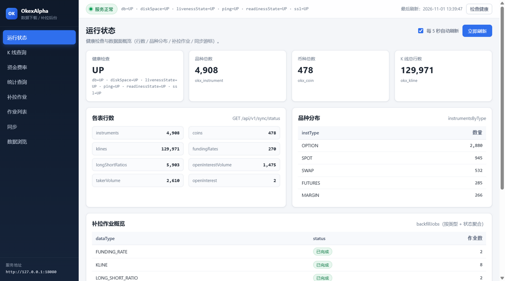
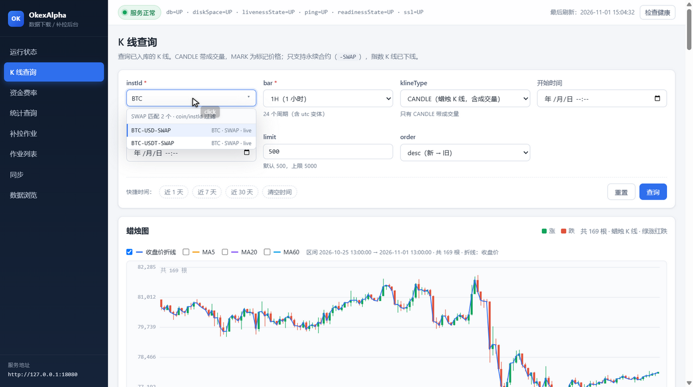
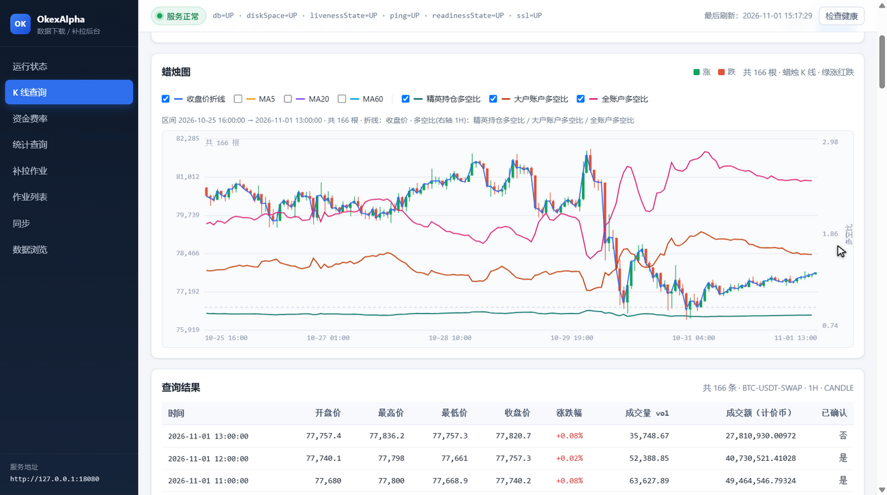
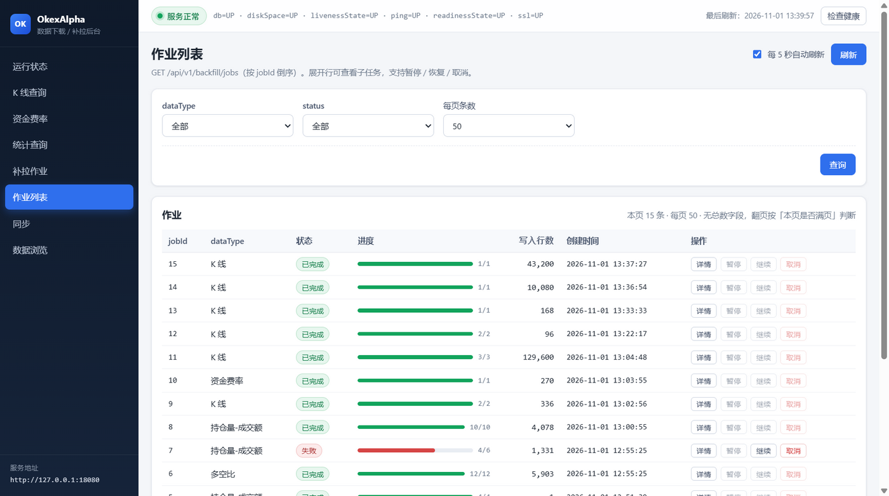
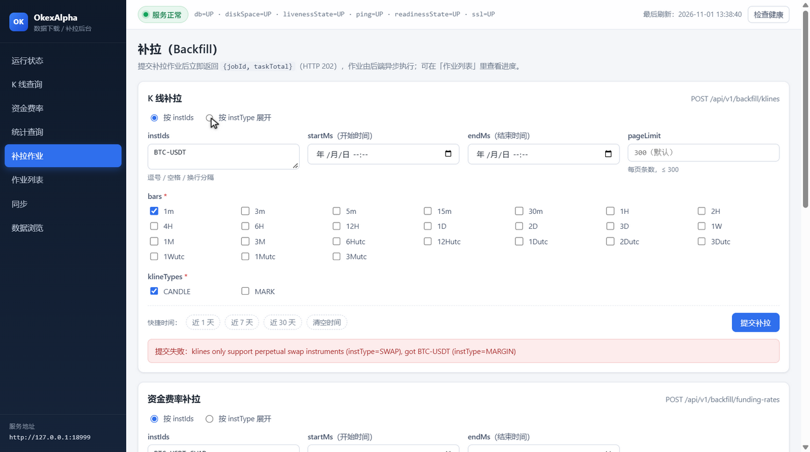

# 后台管理页面

服务自带一个纯静态的单页管理界面，不依赖任何前端框架、包管理器或构建步骤：
HTML/CSS/JS 直接放在 `backend/src/main/resources/static/`，随后端一起打进 jar，由 Spring Boot 的静态资源处理直接服务。

## 界面截图

以下截图均取自真实运行实例（`http://127.0.0.1:18080/`）。



运行状态页：顶栏健康徽标、4 张统计卡、各表行数、品种分布、补拉作业聚合与同步游标。


K 线查询页（整页长图）：查询表单、`<canvas>` 蜡烛图与结果明细表。



instId 输入框的下拉候选：聚焦即展开库内合约，输入 `BTC` 这类 coin 片段即刻过滤。



蜡烛图叠加三条多空比折线（精英持仓 / 大户账户 / 全账户），走右侧独立刻度，灰色虚线是 1.0 多空均衡基准。



作业列表页：进度条与状态徽标、行内操作（详情 / 暂停 / 继续 / 取消）。



补拉页：四张写接口表单；图上展示的是服务端 400 参数校验错误。

## 文件构成

| 文件 | 行数 | 职责 |
| --- | --- | --- |
| `index.html` | 1018 | 页面骨架：顶栏 + 侧边导航 + 8 个路由分区 + 确认弹窗 + toast 容器 |
| `app.js` | 3291 | hash 路由、请求封装、表格/图表渲染（含多空比叠加）、instId 下拉选择器、表单提交与状态轮询 |
| `styles.css` | 705 | 深色主题、卡片、表格、表单、进度条、蜡烛图容器、instId 下拉面板 |

> 行数为当前版本实测值，仅作体量参考。

## 访问

服务启动后浏览器打开：

```text
http://127.0.0.1:18080/
```

- `/` 由 `index.html` 应答，`GET /app.js`、`GET /styles.css` 为同源静态资源，不需要额外启动前端服务。
- 页面所有请求都打在**同源**的 `/api/v1/*` 与 `/actuator/health`，不存在跨域配置。
- 静态资源在打包时进入 jar；改完前端必须重新 `package` 并重启进程才生效（没有 dev server、没有热更新）。
- 访问不存在的路径或缺失的静态文件返回 `404`，响应体形如 `{"code":"NOT_FOUND","msg":"no resource: /nope","data":null}`。

## 布局与通用交互

- **顶栏**：健康状态徽标（初始 `检测中…`，点击可重新检查）、健康详情、`最后刷新` 时间、`检查健康` 按钮。
- **左侧导航**：8 个入口，hash 路由，可直接收藏或刷新；侧栏底部显示服务地址（`location.origin`）。

| 导航 | hash 路由 | 调用 |
| --- | --- | --- |
| 运行状态 | `#/status` | `GET /actuator/health` + `GET /api/v1/sync/status` |
| K 线查询 | `#/klines` | `GET /api/v1/klines` |
| 资金费率 | `#/funding` | `GET /api/v1/funding-rates` |
| 统计查询 | `#/stats` | `GET /api/v1/ratios/long-short`、`/stats/open-interest-volume`、`/stats/taker-volume`、`/stats/open-interest` |
| 补拉作业 | `#/backfill` | 4 个 `POST /api/v1/backfill/*` |
| 作业列表 | `#/jobs` | `GET /api/v1/backfill/jobs`、`GET /api/v1/backfill/jobs/{id}`、`POST /api/v1/backfill/jobs/{id}/pause` 等三个动作 |
| 同步 | `#/sync` | `POST /api/v1/sync/instruments`、`POST /api/v1/sync/basic` |
| 数据浏览 | `#/data` | `GET /api/v1/coins`、`GET /api/v1/instruments` |

通用约定：

- 查询表单的时间输入是浏览器原生 `datetime-local`，提交前换算成 epoch 毫秒的 `startMs` / `endMs`；
  `近 N 天` 与 `清空时间` 是快捷按钮，填充后页面底部提示已填入的时间范围（每页档位不同，见各页说明）。
- `order` 只暴露 `desc`（新 → 旧，默认）与 `asc`（旧 → 新）两项。
- `limit` 为数字输入框或每页条数下拉，越界在前端直接 toast 拦截，不会发出请求。
- 分页（作业 / 币种 / 品种）为 `上一页` / `下一页` + 页码信息；后端不返回总条数，`下一页` 靠「本页是否满页」判断。
- 写操作使用自定义确认弹窗（标题「确认操作」，按钮 `取消` / `确认`，不使用 `window.confirm`）。
  同步品种、组合同步、四个补拉表单、取消作业都会先确认；暂停 / 继续 直接执行。
- 结果以两种方式呈现：页面内 `.alert.danger` 红框（表单下方或结果区）与右下角 toast（成功 / 失败 / 提示），不用浏览器 alert 打断操作。

### instId 下拉选择器

所有 instId 输入框都挂了下拉候选（仍是普通 `<input>` / `<textarea>`，可以继续手打）：

| 页面 | 控件 | 候选范围 |
| --- | --- | --- |
| K 线查询 | `#kline-inst-id` | 只列 `SWAP`（后端同样只接受永续） |
| 资金费率 | `#funding-inst-id` | `SWAP` + `FUTURES` |
| 统计查询 · 持仓量 | `#oi-inst-id` | `SWAP` + `FUTURES` |
| 补拉 · K 线 | `#bf-kline-inst-ids`（多选） | `SWAP` |
| 补拉 · 资金费率 | `#bf-funding-inst-ids`（多选） | `SWAP` + `FUTURES` |
| 补拉 · 多空比 / 成交量 | `#bf-stats-inst-ids`（多选） | `SWAP` + `FUTURES` |

- 候选来自 `GET /api/v1/instruments`（分别取 `instType=SWAP` 与 `FUTURES`、`limit=1000`），首次展开时加载一次并在页面内缓存；请求失败时降级为空列表，不影响手打。
- 过滤词同时匹配 instId 子串与 coin 子串（coin = instId 第一段，如 `BTC-USDT-SWAP` → `BTC`），所以输入 `BTC` 会列出全部 BTC 合约；输入框里已经是一个完整 instId 时按「无过滤」处理，展开即看全部。
- 每行显示 `instId` 与 `coin · instType · state`，面板最多渲染 300 行（超过时头部提示「仅显示前 300」）。
- 键盘：`↑` / `↓` 移动高亮，`Enter` 选中，`Esc` 收起；鼠标：点击输入框展开，点击行选中，点击框外或按 `Esc` 收起。
- 单选直接替换输入值；多选（textarea）追加到逗号列表末尾并保持面板打开，方便连续点选，同时会丢掉刚输入但尚未成型的半截过滤词（例如只打了 `BTC` 就点选，最终写进列表的只有完整 instId）。
- 选择器只做输入辅助，**不做合法性校验**：手打的 instId 仍由后端 / 上游校验并返回 400。

## 空态与提示

| 场景 | 文案 |
| --- | --- |
| 加载中 | `加载中…`（带 spinner） |
| 请求成功但为空 | `暂无数据`、`暂无补拉作业`、`暂无作业`、`暂无记录`、`暂无任务明细` |
| 尚未查询 | `尚未查询` |
| 失败 | 红框内 `<错误信息>` + 对应 toast，如 `K 线查询失败：...` |
| 表单拦截 | 如 `请填写 instId`、`开始时间必须早于结束时间`、`bars 至少选择一个周期` |
| 提交成功 | `已创建作业 jobId=14，任务数 1`、`品种同步完成`、`已暂停作业 15` |

## 1. 运行状态 `#/status`

健康检查与数据面概览，默认每 5 秒自动刷新（`每 5 秒自动刷新` 开关可关闭，关闭后只能点 `立即刷新`）。

| 区块 | 内容 |
| --- | --- |
| 统计卡 | 健康检查 / 品种总数（`okx_instrument`）/ 币种总数（`okx_coin`）/ K 线总行数（`okx_kline`） |
| 各表行数 | `sync/status` 的 `rows`：`instruments`、`coins`、`klines`、`fundingRates`、`longShortRatios`、`openInterestVolume`、`takerVolume`、`openInterest` |
| 品种分布 | `instrumentsByType`，表头 `instType` / `数量` |
| 补拉作业概览 | `backfillJobs`（SQL 原始列名，按 `data_type` + `status` 聚合的作业数），表头 `dataType` / `status` / `作业数` |
| 同步游标 | `cursors`（`okx_sync_cursor`）；当前没有写入方，通常显示 `暂无数据` |

## 2. K 线查询 `#/klines`

副标题注明只支持永续合约（`-SWAP`），指数 K 线已下线。

| 控件 | 默认 | 说明 |
| --- | --- | --- |
| `instId` | `BTC-USDT-SWAP` | 可下拉选择（只列 SWAP）或手打，提示「只支持永续合约 -SWAP」 |
| `bar` | `1H` | 下拉，24 个周期（`1m`…`3M`，含 `6Hutc`、`1Mutc` 等 utc 变体） |
| `klineType` | `CANDLE` | 只有 `CANDLE（蜡烛）` 与 `MARK（标记价格）`，与后端白名单一致 |
| 开始 / 结束时间 | 空 | 即 `startMs` / `endMs` |
| `limit` | `500` | 数字输入，`min=1` `max=5000` |
| `order` | `desc` | 可选 `asc` |
| 快捷时间 | — | 近 1 天 / 近 7 天 / 近 30 天 / 清空时间 |
| 按钮 | — | `重置`（恢复默认）、`查询` |

结果区上半是 `<canvas>` 绘制的蜡烛图（带涨幅/跌幅图例与图表概要），下半是明细表与汇总文案 `共 N 条 · <instId>`。
`MARK` 没有成交量，量相关列为空。

图表工具栏（蜡烛图上方一行）：

| 控件 | 默认 | 说明 |
| --- | --- | --- |
| 收盘价折线 | 勾选 | 在蜡烛图叠加收盘价折线（蓝） |
| MA5 / MA20 / MA60 | 不勾选 | 叠加 5 / 20 / 60 根简单移动平均线（橙 / 紫 / 青），前 N-1 根无值不画 |
| 精英持仓多空比 | 不勾选 | `TOP_TRADER_POSITION`，青绿线，走右轴 |
| 大户账户多空比 | 不勾选 | `TOP_TRADER_ACCOUNT`，橙色线，走右轴 |
| 全账户多空比 | 不勾选 | `LSR_ACCOUNT_CONTRACT`，品红线，走右轴 |
| 区间说明 | — | 形如 `区间 2026-01-01 00:00:00 → 2026-11-01 00:00:00 · 共 305 根 · 折线：收盘价 / MA20`，点多时追加 `按 g 根/列聚合为 M 列` |

图表取数规则（与表格不同）：

- 表格只按 `limit`（默认 500）取一页；**图表按所选时间范围整段读取**，不受 `limit` 限制：
  前端用 `GET /api/v1/klines` 按每页 1000 条、`order=desc`、`endMs=上一页最早 ts-1` 向前翻页，直到覆盖 `startMs`（最多 60 页 / 30000 点）。
- 未填开始时间时不翻页，直接用表格这一页数据。
- 点数超过画布像素列数时按列聚合（开=首根开、收=末根收、高=最高、低=最低），保证整段区间都画得下。
- 超过 30000 点时只保留最近 30000 点，并 toast 提示「区间数据超过 30000 根，图表只显示最近的部分」。
- 时间轴固定 6 个刻度（`fmtShortTime`），左上角显示 `共 N 根`（聚合时附 `（M 列）`）。
- 表格返回条数等于 `limit` 时，汇总文案追加 `· 表格已满 limit=<N>（仅一页），完整区间见上方图表`，避免把「表格一页」误判成「区间数据缺失」（如 1m 全天区间：表格 500 条、图表 3723 根）。

### 多空比叠加

三条 rubik 多空比曲线可叠加在蜡烛图上，走**右侧独立刻度**（多空比量纲与价格量纲不共享），并画一条灰色虚线作为 `1.0` 多空均衡基准。

| 勾选项 | 上游指标 | 颜色 |
| --- | --- | --- |
| 精英持仓多空比 | `TOP_TRADER_POSITION`（rubik `long-short-position-ratio-contract-top-trader`） | 青绿 `#0f766e` |
| 大户账户多空比 | `TOP_TRADER_ACCOUNT`（rubik `long-short-account-ratio-contract-top-trader`） | 橙色 `#c2410c` |
| 全账户多空比 | `LSR_ACCOUNT_CONTRACT`（rubik `long-short-account-ratio-contract`） | 品红 `#db2777` |

取数与对齐规则：

- 数据来自 `GET /api/v1/ratios/long-short`，按**当前 K 线查询的 instId + 时间范围**取：每页 1000 点、`order=asc` 向后翻页，最多 40 页。
- rubik 只提供 `5m / 1H / 1D`，前端按 `bar` 推导能覆盖该周期的**最小**周期：`1m/3m/5m/15m/30m → 5m`、`1H/2H/4H/6H/12H → 1H`、`1D/2D/3D/1W/1M/3M → 1D`（`6Hutc`、`1Mutc` 等 utc 变体同样处理）。
- 序列按 ts 就近落到对应 K 线列（二分查找不晚于该 ts 的那根），聚合时与蜡烛同列。
- **首次勾选才发请求**，相同查询条件命中缓存直接复用；换 `instId` / `bar` / 时间范围自动失效。
- 右轴刻度取三条已勾选序列在可见区间的 min/max，并强制包含 `1.0`（区间不足 0.05 时上下各扩 0.05），因此只勾一条时右轴会贴着这条线自动放大。
- 未查询就勾选会立刻取消勾选并提示「请先查询 K 线，再叠加多空比」；该区间库内无多空比数据时曲线不画，概要文案写 `多空比：库内该区间无数据（可先补拉 ratios）`。

## 3. 资金费率 `#/funding`

| 控件 | 默认 | 说明 |
| --- | --- | --- |
| `instId` | `BTC-USDT-SWAP` | 自由输入 |
| 开始 / 结束时间 | 空 | 过滤 `funding_time_ms` |
| `limit` | `500` | `min=1` `max=1000` |
| `order` | `desc` | 可选 `asc` |
| 快捷时间 | — | 近 7 天 / 近 30 天 / 近 90 天 / 清空时间 |

该页没有重置按钮（与 K 线页不同）。

## 4. 统计查询 `#/stats`

顶部 4 个 tab：`多空比`、`持仓量-成交额`、`主动买卖量`、`持仓量快照`。切换只换面板、不重载页面；
首次进入某个 tab 时才发请求，之后切回沿用已加载的数据。

| tab | 接口 | 主要控件 |
| --- | --- | --- |
| 多空比 | `GET /api/v1/ratios/long-short` | `ratioType` 下拉（4 种，选项带中文释义：多空人数比（按币种）/ 多空人数比（按合约）/ 精英账户多空比 / 精英持仓多空比）、`scope`（默认 `BTC`）、`period`（`5m` / `1H` / `1D`，默认 `1H`）、时间、`limit` 500（`max=1000`）、`order`；快捷近 1 / 7 / 30 天 |
| 持仓量-成交额 | `GET /api/v1/stats/open-interest-volume` | `ccy`（默认 `BTC`）、`period`、时间、`limit`、`order`；快捷近 1 / 7 天 |
| 主动买卖量 | `GET /api/v1/stats/taker-volume` | `scopeKind`（`CCY（按币种）` / `INST（按合约）`，默认 `CCY`）、`scope`（默认 `BTC`）、`period`、时间、`limit`、`order`；快捷近 1 / 7 天 |
| 持仓量快照 | `GET /api/v1/stats/open-interest` | `instId`（默认 `BTC-USDT-SWAP`）、时间、`limit`、`order`；快捷近 1 / 7 天 |

`scope` 的写法随 `ratioType` 变化：`LSR_ACCOUNT_CCY` 填币种（如 `BTC`），其余 3 种填合约（如 `BTC-USDT-SWAP`），
下拉下方提示会随选中类型更新。持仓量快照只有当前值，没有历史回填。

## 5. 补拉作业 `#/backfill`

四张卡片对应四个写接口，流程统一为「填写 → 二次确认 → 提交 → 结果区」；成功后结果区显示 `jobId` 与 `taskTotal`，
并 toast `已创建作业 jobId=<id>，任务数 <n>`。四张卡的按钮都是 `提交补拉`。

| 卡片 | 接口 | 表单要点 |
| --- | --- | --- |
| K 线补拉 | `POST /api/v1/backfill/klines` | 模式二选一：`按 instIds`（默认，文本域初始 `BTC-USDT-SWAP`）/ `按 instType 展开`（`instType` + 可选 `baseCcy`）；`bars` 复选（24 个，默认勾 `1H`）；`klineTypes` 复选（`CANDLE` 默认勾、`MARK` 默认不勾）；`startMs` / `endMs`；`pageLimit`（占位 `300（默认）`，`min=1` `max=300`）；快捷近 1 / 7 / 30 天 |
| 资金费率补拉 | `POST /api/v1/backfill/funding-rates` | 同样的模式二选一（文本域初始 `BTC-USDT-SWAP`）+ 时间；快捷近 7 / 30 / 90 天 |
| 多空比补拉 | `POST /api/v1/backfill/ratios` | `ratioTypes` 复选（4 种，默认只勾 `LSR_ACCOUNT_CCY`）、`ccys` 文本域（默认 `BTC`）、`scopes` 文本域（默认 `BTC-USDT-SWAP`）、`periods` 复选（默认勾 `1H`）、时间；快捷近 1 / 7 / 30 天 |
| 持仓量 / 成交额 / 主动买卖补拉 | `POST /api/v1/backfill/market-stats` | `kinds` 复选（`OPEN_INTEREST_VOLUME` 默认勾、`TAKER_VOLUME`、`OPEN_INTEREST`；留空 = 三种全跑）、`ccys`（默认 `BTC`）、`instIds`（默认 `BTC-USDT-SWAP`）、时间、`periods`（默认 `1H`）；快捷近 1 / 7 天 |

K 线补拉要求标的在库里是 `instType=SWAP`：`按 instType 展开` 选中非 SWAP 品种时后端返回 400，
页面把 `msg` 原样显示在红色错误框里（补拉页截图即该场景）。资金费率同理只适用于衍生品。
市场统计卡的口径提示（页面 hint 原文）：`OPEN_INTEREST_VOLUME` 需要 `ccys`；`TAKER_VOLUME` 的 INST 维度用 `instIds`；
`OPEN_INTEREST` 留空 `instIds` 时取库内全部 SWAP。

## 6. 作业列表 `#/jobs`

- 过滤条件：`dataType`（全部 + 6 种）、`status`（全部 + 6 种）、`每页条数`（20 / 50 / 100，默认 50）。
  `查询` 提交过滤，`刷新` 重新拉取当前页，`每 5 秒自动刷新` 开关默认开启。
- 列表列：`jobId`、`dataType`（显示中文标签：K 线 / 资金费率 / 多空比 / 持仓量-成交额 / 主动买卖量 / 持仓量快照）、
  `状态`（徽标：待执行 / 执行中 / 已暂停 / 已完成 / 失败 / 已取消）、`进度`（进度条 + `done/total`）、
  `写入行数`、`创建时间`、`操作`。
- 操作按钮按状态机禁用：`暂停` 仅 `PENDING` / `RUNNING`，`继续` 仅 `PAUSED` / `FAILED`，`取消` 对 `DONE` / `CANCELED` 禁用。
  **只有 `取消` 弹确认框**（标题「取消作业」，附注「已写入的数据不会回滚」）；`暂停` / `继续` 直接发请求。
  后端仍会独立校验，非法操作返回 409 并 toast 错误信息。
- `详情` 行内展开（请求带 `includeTasks=true`）：
  - 作业信息：`jobId`、状态、任务进度、写入行数、创建 / 开始 / 结束时间、`error`（非空时红框显示）、`request` 的格式化 JSON；
  - 任务表：`id`、`taskKey`、`状态`、`cursorMs`、`pageCount`、`rowsWritten`、`attempts`、`truncated`（是/否）、`lastError`。
- 空结果 `暂无作业`；展开后无子任务时 `暂无任务明细`。

## 7. 同步 `#/sync`

副标题提示两个接口都是同步阻塞调用，可能需要数分钟。

| 表单 | 接口 | 字段 |
| --- | --- | --- |
| 同步品种 | `POST /api/v1/sync/instruments` | `instTypes` 复选（5 类，默认全选；全不选 = 后端按默认处理）、`includeOptions`（默认勾选，逐家族拉期权最慢）、`families`（逗号分隔，留空自动推断）；按钮 `开始同步` |
| 组合同步 | `POST /api/v1/sync/basic` | `instTypes` 复选（默认只勾 `SWAP`）、`includeOptions`（默认不勾）、`families`、`instType` 下拉、`maxInstruments`（20，`[1,500]`）、`maxCcys`（10，`[1,100]`）、`days`（7，`[1,365]`）、`bars`（文本，默认 `1H`）、`includeFunding` / `includeRatios`（默认勾）、`klineTypes` 复选（默认只勾 `CANDLE`）、`ratioTypes` 复选（默认勾 `LSR_ACCOUNT_CCY` 与 `TOP_TRADER_POSITION`）；按钮 `开始组合同步` |

两个表单提交前都会弹确认框，等待期间显示已耗时并提示不要刷新页面。
同步品种是**整表重建** `okx_coin`：重建瞬间该表为空，完成后应回到状态页刷新查看。
组合入口传非 `SWAP` 的 `instType` 不会报错，而是把对应能力标成 `skipped: ...` 写进响应 `data`（见 [API.md](API.md)）。

## 8. 数据浏览 `#/data`

| 区块 | 接口 | 控件 |
| --- | --- | --- |
| 币种 | `GET /api/v1/coins` | `channel`（全部 / SPOT / MARGIN / SWAP / FUTURES / OPTION）、`q`（币种模糊匹配）、`每页条数`（20 / 50 / 100，默认 50）、上一页 / 下一页 |
| 品种 | `GET /api/v1/instruments` | `instType`（全部 + 后端枚举）、`baseCcy`、`state`（全部 / `live` / `suspend` / `expired` / `preopen`）、`每页条数`、上一页 / 下一页 |

两个接口都不返回总条数，页面按「本页是否满页」决定 `下一页` 是否可用；首次进入显示 `尚未查询`。

## 与 API 文档的关系

页面只调用 [API.md](API.md) 中已有的后端端点，不额外新增接口；每个字段的含义、默认值与错误码以 API 文档为准。

页面本身不鉴权、不做权限区分，适合本机或内网使用；不要把端口直接暴露到公网。
