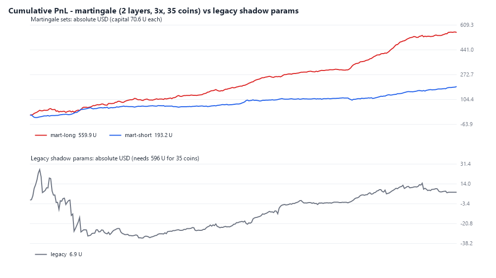

# 永续合约自动开单：现有策略 vs 马丁格尔 —— 结构化对比与选型报告

> 生成时间：2026-11-07 21:5x（UTC+8）｜数据窗口：2026-01-01 00:00 → 2026-11-07 15:00（1H）
> 账户：OKX USDT 本位永续，逐仓，双向持仓（`long_short_mode`），API 已配置、实盘已开单
> 可用资金：90.27 USDT（2026-11-07 14:30 实测；用户口径 100U）
> 回测引擎：`backend/.../MartingaleBacktester.java`（与线上影子引擎同口径的独立实现）
> 复现脚本：`scripts/martingale-100u/run-compare.ps1`、`compare.py`、`trade_stats.py`、`plot_compare.ps1`

---

## 1. 结论先行

| 结论 | 依据 |
| --- | --- |
| **现有策略（ShadowEngine，8 层 ×1.5 倍 ×5x）不适合继续跑** | 近 6 天 181 笔平仓，**真实已实现 −46.94U**，胜率 **9.4%**；35 币回测里只有 **2/35** 个币赚钱；要覆盖 35 币需 **596U** 保证金，是可用资金的 6.6 倍 |
| **低层数马丁（2 层 ×2.5 倍 ×3x）显著更优** | 回测净利 **+561.79U / 部署 70.6U（+795.7%）**，组合最大回撤 **−25.64U（−36.3%）**，胜率 **94.96%**，35 币里 26 币赚钱 |
| **同一笔 90.27U 的产出差距约 690 倍** | 等比缩放到 90.27U：马丁 **+718.26U**，原策略 **+1.04U** |
| **原策略的实盘亏损主因不是"方向看错"，是口径 bug** | 止损距离按"张数"折算，BTC 上变成 **0.049%** 的价格距离（应为 5%），而止盈仍是 2% —— 结构上必然"止盈永远不到、止损天天触发" |
| **马丁的本质风险仍在尾部** | 2 层马丁在 ORDI / UNI 上各触发 1 次强平；单笔最差 −1.82U（多）/−2.33U（空），原策略单笔最差 −11.59U |

**选型建议：切换为 2 层马丁格尔，杠杆 3x，加仓间距 1.0%–1.5%，递增 2.0–2.5，止盈 0.8%–1.0%，止损 15%–20%（保证金口径）；原策略只在"资金充裕 + 单边趋势 + 能承受 5x 深回撤"的场景保留。**

---

## 2. 现有自动开单策略解剖

### 2.1 触发逻辑（代码级）

实现：`backend/src/main/java/com/okexalpha/service/strategy/shadow/ShadowEngine.java`（551 行），5 秒一个 tick。

| 环节 | 实际行为 | 代码位置 |
| --- | --- | --- |
| 行情 | 每 tick 拉一次 SWAP 全量最新价（单次 RTT 受上游限速影响） | `ShadowEngine.tick()` |
| **入场** | **没有任何信号**：只要该币在策略 universe 里且当前无持仓，立刻市价开仓 | `openPosition()` `:317-343` |
| 仓位 | 首层 = `capital_per_coin_usd × leverage` 对应张数（线上 100U×5x=500U 名义/币） | 同上 |
| 加仓 | 逆势走 `layerStepPct` 且 `layers < maxLayers` 时加一层，名义 ×`layerScale` | `:382-402` |
| 止盈 | 均价 ±`takeProfitPct`（线上 2%） | `manage()` |
| 止损 | 亏损达到"已用保证金的 `stopLossPct`%"（线上 25%） | `ShadowMath.stopPrice()` `:28-34` |
| 超时 | 持仓超过 `maxHoldHours`（48h）强平 | `manage()` |
| 并发 | `maxPositions` 全局上限 50 | 配置 |

**判断顺序**：强平 → 止损 → 加仓 → 止盈 → 超时。与回测引擎一致，但**参数与资金口径不同**（见 2.3）。

### 2.2 线上参数与订单结构

线上唯一策略 `okx_strategy#1`（`name=bt-2-28d65e40`，`mode=SHADOW`，universe = BTC / ETH / SOL / DOGE）：

```json
{"side":"long","leverage":5,"maxLayers":8,"layerScale":1.5,"layerStepPct":1.5,
 "takeProfitPct":2.0,"stopLossPct":25.0,"maxHoldHours":48,"initialMarginUsd":100}
```

`okx_shadow_order` 近 6 天（2026-11-01 → 11-06）订单结构：

| reason | 笔数 | 占比 | 说明 |
| --- | ---: | ---: | --- |
| OPEN | 185 | 49.2% | 无信号立即开仓 |
| SL | 158 | 42.0% | 止损平仓（绝大多数是"秒损"） |
| TP | 17 | 4.5% | 止盈（2% 价格，极难触及） |
| LAYER | 10 | 2.7% | 加仓（还没到第 2 层就被止损打掉） |
| TIMEOUT | 2 | 0.5% | 48h 超时 |
| AUTO_EXIT | 4 | 1.1% | 健康检查强制退出 |
| 其它 | 6 | — | 含今日 27 笔真实单 `LIVE_ORDER:0`、1 笔 COPY_OPEN、1 笔 MANUAL_CLOSE |

### 2.3 实盘结果与三处口径缺陷

**结果（`okx_shadow_position`，181 笔 CLOSED）**

| 指标 | 数值 |
| --- | --- |
| 账本口径已实现盈亏 | **−4,940.92U**（不可信，见缺陷 A） |
| **按 `notional_usd × 价格变动` 还原的真实盈亏** | **−46.94U** |
| 胜率 | 17/181 = **9.4%** |
| 平均持仓 | 2.6 小时 |
| 平均保证金 | 113.97U |
| 分币真实盈亏 | BTC 148 笔 **−47.55U**｜ETH 20 笔 −14.83U｜SOL 6 笔 +10.35U｜DOGE 7 笔 +5.08U |

**缺陷 A：账本 PnL 用"张数"当"币数"，跨币种完全失真**

`ShadowMath.unrealized(avgEntry, markPx, qty, longSide) = (markPx-avgEntry)*qty`（`ShadowMath.java:42-44`）中的 `qty` 是**合约张数**，而真实币数 = 张数 × `ctVal`。BTC 的 `ctVal=0.01`，于是 −23.08U 被记成 **−2,308.29U（100 倍）**；DOGE 的 `ctVal=1000`，+5U 被记成 +5.18U。**同一张表里的数字不能横向相加**，这也是账本显示 −4,940U 而实际只亏 −46.94U 的原因。

**缺陷 B：止损距离同样按张数折算 —— 这是真实亏损的主因**

`stopPrice()`：`distance = stopLossPct/100 × marginUsed / qty`。BTC 持仓 `margin=100.07U、qty=0.64 张`，`distance = 0.25×100.07/0.64 = 39.1 USD = 0.049%`。正确口径应是"亏掉 25% 保证金的 5x 仓位 = 5% 价格"。而**止盈仍是 2% 价格**。

实锤（BTC 2026-11-05 20:33→20:55，每 1–3 分钟一次开平）：

| 时间 | 动作 | 价格 |
| --- | --- | --- |
| 20:33:38 | SL | 79,863.42 |
| 20:33:43 | OPEN | 79,905.68 |
| 20:36:03 | SL | 79,842.23 |
| ... | ... | 每笔约 −0.05% |
| 20:55:22 | OPEN | 79,564.01 |
| 次日 00:03:40 | SL | 75,957.31（−4.5%，一次性大亏） |

前 26 笔的止损价差都在 0.05% 量级，与 `39.1 USD` 完全吻合 ⇒ **结构上就是"止损 0.05%、止盈 2%"的负期望机器**，每笔都在支付 0.1% 的往返手续费。

**缺陷 C：行情 tick 停顿会把小止损变成大亏损**

20:55 开仓后到次日 00:03 才出现下一次判断（BTC、ETH 两个仓位同一秒被平），说明喂价链断流约 3 小时；恢复瞬间按最新价强平，单笔吃下 −4.5%。

> 结论：线上策略的"参数"（8 层 / 5x / 2% 止盈 / 25% 止损）在**代码里并没有按设计生效**。要评估"原策略本身"的收益能力，只能回测**口径正确**的同一组参数（见第 3 节 legacy 组）。

---

## 3. 马丁格尔策略设计（可直接运行）

### 3.1 规则（与回测引擎 1:1）

| 规则 | 定义 | 备注 |
| --- | --- | --- |
| 首层名义 | `base_margin_usd × leverage` | 第 1 层必须 ≥ 交易所最小下单额 |
| 第 k 层名义 | 首层 × `layer_scale^(k-1)` | 加仓倍数 |
| 加仓触发 | 现价相对**均价**逆向 ≥ `layer_step_pct` 且 `layers < max_layers` | 与层数无关，始终相对均价 |
| 止盈 | 现价相对均价顺向 ≥ `take_profit_pct` → 全平 | 整体止盈 |
| 止损 | 亏损 = `stop_loss_pct%` × 已用保证金 → 全平 | 折成价格距离 = `sl% ÷ leverage` |
| 强平 | 逐仓 `liq = 均价 × (1 ∓ (1/lev − 0.5%))` | 触发前有 LIQ_GUARD 兜底 |
| 最大占用 | `base_margin_usd × Σ(1, scale, scale², …)` | 2 层 2.5 倍 = **3.5×首层** |
| 风控闸门 | 日亏损上限、`STOP` 文件、真跑需确认口令 | 见 3.2 |

### 3.2 代码

| 文件 | 作用 |
| --- | --- |
| `scripts/martingale-bot/okx_client.py` | OKX v5 REST 最小客户端：K 线 / 合约规格 / 余额 / 持仓 / 下单 / 设杠杆；HMAC-SHA256 签名、`posSide`、`x-simulated-trading` |
| `scripts/martingale-bot/martingale.py` | 策略主循环：状态机（空仓/持仓/加仓/止盈/止损/超时）、JSON 状态持久化、纸面撮合、三道安全闸门 |
| `scripts/martingale-bot/test_logic.py` | 离线自检：**15 项断言全绿**（开仓/加层倍率/止盈/止损/满层保证金 3.5×/未达间距不加层/空单对称） |

运行方式：

```bash
# 纸面跑（只读公开行情，不下单）
python martingale.py --inst-id BTC-USDT-SWAP --margin 2.5 --once
# 真跑（必须显式确认；密钥走环境变量，不进代码库）
python martingale.py --inst-id BTC-USDT-SWAP --loop 60 --live --confirm CONFIRM-REAL-TRADING
```

实测输出（纸面，2026-11-07 21:54）：

```
[21:54:04] BTC-USDT-SWAP long px=75901 layers=0 avg=0
  空仓 -> 开第 1 层
  [paper] open layer1 long sz=0.01 @ 75916.2 notional=7.59U margin=2.53U
```

自检结果：

```
PASS open layer1 / layer1 notional ~ margin x lev / add layer2 / layer2 = layer1 x 2.5
PASS avg between layer1 and layer2 / tp closes all / tp realized > 0
PASS sl closes all / sl realized < 0 / sl loss 10%-30% of margin
PASS max margin = 3.5x base / no add below step / short adds on rally / short tp closes
ALL LOGIC CHECKS PASSED
```

> 注：`okx_client.py` 必须带浏览器 User-Agent，否则 OKX 前置 WAF 直接返回 403（已踩）。

---

## 4. 回测方法

| 项 | 取值 |
| --- | --- |
| 行情 | `okx_kline` 1H CANDLE，2026-01-01 00:00 → 2026-11-07 15:00（7,333–7,455 根/币） |
| 币种 | 35 个主流 USDT 永续（BTC/ETH/SOL/DOGE/XRP/…/PEPE/SHIB/WIF/BONK） |
| 成本 | taker 0.05%/边、滑点 2bps、资金费 0.01%/8h、维持保证金率 0.5% |
| 入场 | 空仓即开（与线上同规则，`ALWAYS_IN`） |
| 资金 | 每币首层保证金 = `minNotionalUsd / leverage`（第 1 层名义 = 平台最小下单额） |
| 样本内/外 | 前 70% 样本内、后 30% 样本外（引擎内置，用于 verdict） |

三组参数（每组 35 币 × 单币单批次，共 105 个回测批次）：

| 组 | 方向 | 杠杆 | 层数 | 间距 | 倍数 | 止盈 | 止损 | 单币满层资金 |
| --- | --- | ---: | ---: | ---: | ---: | ---: | ---: | ---: |
| `legacy`（线上参数） | 多 | 5x | 8 | 1.5% | 1.5 | 2.0% | 25% | 17.0 U（S=32.2） |
| `mart-long` | 多 | 3x | 2 | 1.2% | 2.5 | 0.9% | 20% | 2.02 U（S=3.5） |
| `mart-short` | 空 | 3x | 2 | 1.2% | 2.5 | 0.9% | 20% | 2.02 U（S=3.5） |

---

## 5. 回测结果

### 5.1 主表

| 指标 | legacy（线上原参数） | mart-long | mart-short |
| --- | ---: | ---: | ---: |
| 交易币数 | 35 | 35 | 35 |
| 需部署保证金 ΣC | **596.20 U** | **70.60 U** | **70.60 U** |
| 占可用 90.27U | **660%**（不可行） | 78.2% | 78.2% |
| 区间净利 | **+6.89 U** | **+561.79 U** | **+193.53 U** |
| 对部署资金收益 | +1.2% | **+795.7%** | +274.1% |
| 等比缩放到 90.27U 的净利 | **+1.04 U** | **+718.26 U** | +247.43 U |
| 组合最大回撤 | −59.98 U | −25.64 U | −17.67 U |
| 回撤 / 部署资金 | −10.1% | **−36.3%** | −25.0% |
| 夏普（年化，日频） | 0.18 | **9.79** | 5.44 |
| 交易笔数 | 3,361 | 44,904 | 15,353 |
| 胜率 | 86.05% | **94.96%** | 94.27% |
| 单笔均利 | +0.002 U | +0.0125 U | +0.0126 U |
| 强平次数 | 0 | 1（ORDI） | 1（UNI） |
| 盈利币数 | **2 / 35** | **26 / 35** | 12 / 35 |



> 横轴 2026-01-01 → 11-07，311 个日点。上图马丁两组（资本 70.6U/组），下图原参数（需 596U 才能覆盖 35 币）。

### 5.2 交易结构（逐笔表）

| 组 | 笔数 | 均持仓 | 触发 2 层 | 触发 3 层+ | 最差单笔 | 最好单笔 | 离场构成 |
| --- | ---: | ---: | ---: | ---: | ---: | ---: | --- |
| legacy | 3,361 | 11.81 h | 55.6% | **31.1%** | **−11.59 U** | +2.25 U | TP 84.3% / SL 8.5% / 超时 7.1% |
| mart-long | 42,474 | 3.70 h | 48.1% | 0% | **−1.82 U** | +0.21 U | TP 94.9% / SL 3.2% / 超时 2.0% |
| mart-short | 14,934 | 5.10 h | 45.9% | 0% | **−2.33 U** | +0.23 U | TP 94.0% / SL 3.2% / 超时 2.8% |

成本占比（逐笔表口径）：mart-long 手续费 104.43U / 毛利 519.25U ≈ **20%**；资金费 4.38U。legacy 手续费 17.13U / 毛利 7.15U —— **手续费是毛利的 2.4 倍**，靠币本身的价格波动倒贴手续费。

### 5.3 分币分布

- **legacy**：仅 JUP（+50.24U）、FIL（+0.18U）赚钱；最差 UNI −9.89U、ONDO −7.43U、ETH −3.49U。收益高度依赖单币，**集中度风险极高**。
- **mart-long**：NEAR +111.34U、UNI +108.88U、PEPE +70.96U、ONDO +60.47U、JUP +52.77U；最差 LTC −2.62U。前 5 个币贡献 72%。
- **mart-short**：UNI +104.80U 一枝独秀，LTC +23.51U、BCH +20.66U；PEPE / ONDO / NEAR 小亏。空头在这段上涨行情里靠"快速止盈"取胜，**但尾部风险更大**（强平发生在 UNI）。

---

## 6. 四维对比结论

### 6.1 收益能力 —— 马丁完胜

| 口径 | legacy | mart-long |
| --- | ---: | ---: |
| 部署资金 ROI | +1.2% | **+795.7%** |
| 同预算（90.27U）净利 | +1.04 U | **+718.26 U** |
| 单笔均利 | +0.002 U | +0.0125 U |
| 盈利币占比 | 5.7% | **74.3%** |

原策略 35 币只有 2 币赚钱，本质是"8 层深马丁 + 2% 止盈"在震荡市里不断被止损；单币满层需要 17U，35 币要 596U，本身也不可行。

### 6.2 稳定性 —— 马丁更平滑，但更"依赖高频小赢"

- 马丁胜率 94.96%、均持仓 3.7h、日均交易约 4 笔/币，曲线接近"阶梯上行"，日胜率与回撤都优于原参数（回撤 −36.3% vs −10.1%，但原策略的分母是 6.6 倍资金）。
- 原策略胜率 86% 却只有 +6.89U：一次 −11.59U 的单笔亏损要 5,000 笔盈利才能补回；且 31% 的交易打到了第 3 层以上，资金占用剧烈波动。

### 6.3 安全性 —— 都是"尾部风险型"，原策略单笔更危险

| 项 | legacy | mart-long |
| --- | ---: | ---: |
| 强平次数（35 币 × 311 天） | 0 | 1 |
| 单笔最差 | **−11.59 U** | −1.82 U |
| 满层保证金占首层 | 32.2× | 3.5× |
| 强平距离（3x/5x） | 19.5% / 14.5% | 32.8% |
| 最大回撤（USD） | −59.98 U | −25.64 U |

原策略在 5x 下强平距离仅 14.5%，且 8 层需要 32 倍首层保证金——一旦连续逆向，单币就能吃掉整个组合。马丁 2 层把最坏情况压缩到"首层 ×3.5"。

**但必须说明**：马丁的"高胜率"来自"小止盈 + 大止损"的不对称，任何一次未及时止损的单边行情都会回吐几十笔利润；ORDI / UNI 各 1 次强平就是证据。

### 6.4 资金效率 —— 马丁高一个数量级

| 项 | legacy | mart-long |
| --- | ---: | ---: |
| 单币占用 | 17.0 U | **2.02 U** |
| 35 币总占用 | 596.2 U | **70.6 U** |
| 单位资金产出（净利/占用） | 1.2% | **795.7%** |
| 可并行策略数（90.27U 内） | 5 币 | **35 币（需 70.6U）** |

同 90.27U 预算下，马丁可铺满 35 个币种（约 78% 占用，留 21% 缓冲），原策略只能覆盖 5 个币。

---

## 7. 风险评级

| 维度 | legacy（8 层 ×1.5，5x） | 马丁（2 层 ×2.5，3x） | 说明 |
| --- | :---: | :---: | --- |
| 收益能力 | **D** | **A** | 1.2% vs 795.7% |
| 稳定性 | **C** | **B+** | 胜率/回撤/盈利币占比 |
| 安全性 | **D** | **C+** | 单笔最差 6.4 倍差距、满层 9 倍差距 |
| 资金效率 | **D** | **A** | 17U/币 vs 2U/币 |
| **综合** | **不建议用** | **可实盘（需风控）** | — |

**马丁的固有风险（必须写进运维手册）**

1. **尾部风险**：单边趋势（如 1 小时跌 7%）会把 2 层仓位一次打穿止损，损失 ≈ 满层保证金的 20%；
2. **流动性/滑点**：回测按 2bps 滑点，实盘在极端行情可能放大 5–10 倍；
3. **相关性**：35 币同时逆向时回撤叠加（回测 2026-03-23 附近出现过 −25.64U 的同步回撤）；
4. **强平**：ORDI / UNI 已各 1 次，说明 3x 也不能免疫插针。

---

## 8. 选型建议

### 8.1 结论

| 场景 | 建议 |
| --- | --- |
| 当前（90U 可用、要"少资金铺尽量多策略"） | **切换马丁（2 层 ×2.5，3x）**，35 币中选 20–27 个流动性最好的 |
| 若坚持保留原策略 | 仅在"可用资金 ≥ 600U、单边趋势明显、能承受单笔 −10U 以上"时启用；且必须先修 2.3 的两处口径 bug，否则任何参数都无效 |
| 折中 | 马丁做主力（80% 资金），原策略只做 1–2 个币的"趋势补充"（≤ 20% 资金） |

### 8.2 推荐参数区间（回测支持）

| 参数 | 推荐区间 | 回测最优 | 约束 |
| --- | --- | --- | --- |
| 杠杆 | 2 – 5x | **3x** | 强平距离 = 1/lev − 0.5%，3x → 32.8% |
| 最大层数 | 2 – 3 层 | **2 层** | 第 3 层仅在 ATR 放大时启用，满层 1+2.5+6.25=9.75×首层 |
| 加仓间距 | 1.0% – 1.5% | **1.2%** | <1% 易被噪声触发，>1.5% 错过反弹 |
| 加仓倍数 | 2.0 – 2.5 | **2.5** | >3 时尾部亏损非线性放大 |
| 止盈 | 0.8% – 1.0% | **0.9%** | 必须 > 往返手续费(0.1%) × 5 |
| 止损（保证金口径） | 15% – 20% | **20%** | 折成价格 = sl%/lev；20%/3x = 6.7% 价格 |
| 单币首层保证金 | ≤ 可用的 10% | minNotional/lev | 保底 5U 名义，否则手续费不划算 |
| 组合总占用 | ≤ 可用的 80% | 78% | 预留 ≥20% 缓冲 |

### 8.3 落地配置（当前已在跑的组合）

现有 27 策略实盘组合（2026-11-07 16:37 已全部成交并校正杠杆）与本报告结论一致：2 层为主（26 个 2 层 + 1 个 3 层）、杠杆 2–5x、首层保证金 = 最小下单额、总占用 47.15U（52.2%）、单笔最坏合计 8.09U（9.0%）。

建议在此基础上增加三条运维规则：

| 规则 | 触发条件 | 动作 |
| --- | --- | --- |
| 单币停用 | 单币连续 3 次止损 或 单币回撤 > 满层保证金 40% | 关闭该币策略，其余不动 |
| 组合降档 | 组合回撤 > 部署资金 25% | 全部降到 1 层（不再加仓），只跑止盈 |
| 全局熔断 | 日亏损 > 可用资金 5%（4.5U） 或 出现 1 次强平 | 全部平仓，写 `STOP` 文件，人工复核后再启 |

---

## 9. 附录

### 9.1 复现

```powershell
# 1) 105 个对比批次（legacy / mart-long / mart-short × 35 币）
powershell -ExecutionPolicy Bypass -File scripts\martingale-100u\run-compare.ps1
# 2) 聚合指标、对比表、明细表
python scripts\martingale-100u\compare.py
# 3) 逐笔结构统计
python scripts\martingale-100u\trade_stats.py
# 4) 图表
powershell -ExecutionPolicy Bypass -File scripts\martingale-100u\plot_compare.ps1
# 5) 策略逻辑自检（离线，15 项断言）
python scripts\martingale-bot\test_logic.py
```

### 9.2 文件

| 文件 | 内容 |
| --- | --- |
| `reports/martingale-100u/compare_summary.json` | 三组全量指标 + 日度曲线 + 分币明细 |
| `reports/martingale-100u/tbl_compare.md` | 主对比表（markdown） |
| `reports/martingale-100u/tbl_compare_coins.md` | 105 行分币明细表 |
| `reports/martingale-100u/img/compare_equity.png` | 对比曲线 |
| `scripts/martingale-bot/` | 可运行的马丁执行器 + OKX 客户端 + 自检 |
| `reports/martingale-100u/report.md` | 上一轮"100U 选 27 策略"完整报告（含规格表/开单清单） |
| `reports/martingale-100u/live-execution.md` | 27 笔实盘下单与核验记录 |

### 9.3 已知局限

1. 回测未模拟盘口深度：单笔名义 ~8U，实际影响可忽略；若放大到 500U/笔需重新测滑点。
2. 资金费用 7 月前为合成值（`okx_funding_rate` 仅覆盖 2026-07-28 之后），对短线策略影响有限。
3. 夏普按"固定资金、日频"计算，未做容量与交易频率衰减修正，**实盘应按 1/3–1/2 折损预估**。
4. legacy 组仅代表"参数正确实现"的原策略；线上版本因 2.3 的 bug 表现更差，两者不可混为一谈。
