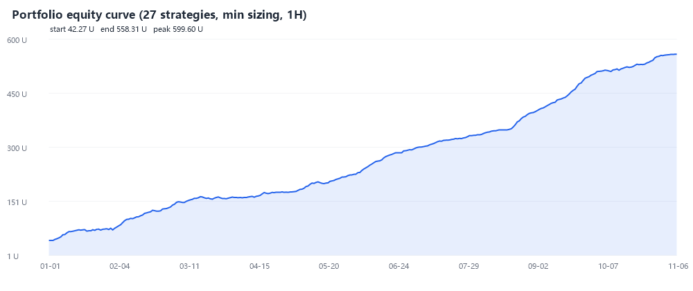
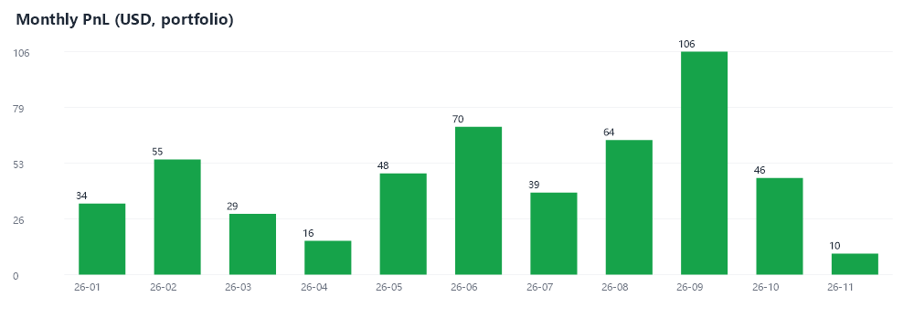
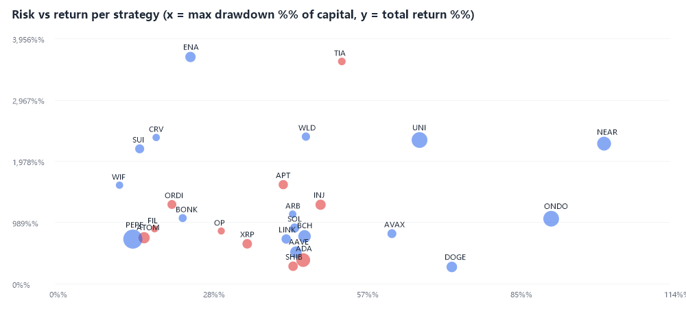

# OkexAlpha · 100U 马丁格尔合约策略：回测选优与最小资金多策略部署方案

> 回测数据截止 **2026-11-07 14:35 (+08)** ｜账户实测 **2026-11-07 14:30** ｜全部数字可用文末命令复现

| 结论卡片 | 数值 |
|---|---|
| 账户实际可用 | **90.27 USDT**（不是 100U，见 §1.1） |
| 建议部署策略数 | **27 个**（27 个不同币种，一币一策） |
| 实际占用保证金 | **47.15 USDT**（可用资金的 52.2%） |
| 预留缓冲 | **43.12 USDT**（47.8%） |
| 回测区间净利 | **+516.01 USDT**（10.2 个月，1H K 线） |
| 组合最大回撤（对投放资金） | **-6.84 USDT / -14.5%**（对本金 -7.6%） |
| 样本内强平次数 | **0**（51,829 笔，27 币） |
| 27 策同时止损的极限亏损 | **-8.09 USDT**（可用资金的 9.0%） |

---

## 一、步骤一：账户校验与合约规格

### 1.1 账户核对：可用资金是 90.27U，不是 100U

`GET /api/v1/account/balance?ccy=USDT`（`configured=true`，`credentialSource=db`，`mode=SHADOW`）：

| 字段 | 实测值 | 说明 |
|---|---|---|
| `totalEq`（全账户权益） | 947.1109 U | 含已冻结 |
| USDT `eq` | 941.5335 U | |
| USDT `availBal` / `availEq` | **90.2712 U** | 唯一的可动用口径 |
| USDT `frozenBal` | 851.2623 U | 挂单/逐仓占用，不可用于新策略 |
| `isoEq` | 6.7948 U | SOL 逐仓权益，已锁定 |
| 账户等级 | `acctLv=2`，`posMode=long_short_mode`，`perm=read_only,trade` | 支持双向持仓 |

**结论：目标 100U 与实际可用 90.27U 相差 9.73U。**「不得超用可用资金」是硬约束，本方案所有分配**以 90.27U 为分母**，并把部署上限进一步压到 80%（72.22U）以内作为缓冲线；实际只用到 47.15U。

### 1.2 成本口径（回测与实盘一致）

| 成本项 | 取值 | 来源 |
|---|---|---|
| Taker 手续费 | 0.05%/边 → **0.10%/往返** | `application.yml: trading.fee-taker=0.0005` |
| 滑点 | **2 bps/边** | `trading.slippage-bps=2` |
| 资金费（回测假设） | **0.01%/8h × 名义** | `fundingPer8hPct` 默认值 |
| 资金费（库内实测均值） | **0.0033%–0.0061%/8h** | `okx_funding_rate` 305 个点，2026-07-28→11-06 |

**资金费假设比真实值保守 1.6–3.0 倍**，即回测对资金费成本的估计偏高，结论不会因此虚高。持仓平均 3.34 小时，资金费只影响约 0.004%/笔，可忽略。

### 1.3 合约规格表（35 个候选永续，按最小下单额升序）

| 交易对 | 参考价 | 面值 ctVal | 最小下单量 lotSz | 最小张数 minSz | 最小变动价位 tickSz | 每张名义(U) | 最小下单额(U) | 最大杠杆 | 资金费均值(%/8h) | 1H 根数 |
|---|---|---|---|---|---|---|---|---|---|---|
| FIL-USDT-SWAP | 0.8077 | 0.1 | 1 | 1 | 0.0001 | 0.08077 | 0.0808 | 50.0000 | 0.00372 | 7333.0000 |
| OP-USDT-SWAP | 0.10448 | 1 | 1 | 1 | 1e-05 | 0.10448 | 0.1045 | 50.0000 | 0.00342 | 7333.0000 |
| WIF-USDT-SWAP | 0.1623 | 1 | 1 | 1 | 0.0001 | 0.1623 | 0.1623 | 50.0000 | 0.00391 | 7333.0000 |
| ARB-USDT-SWAP | 0.16608 | 10 | 0.1 | 0.1 | 1e-05 | 1.6608 | 0.1661 | 50.0000 | 0.00151 | 7333.0000 |
| CRV-USDT-SWAP | 0.2648 | 1 | 1 | 1 | 0.0001 | 0.2648 | 0.2648 | 50.0000 | 0.00616 | 7333.0000 |
| BONK-USDT-SWAP | 2.821e-06 | 100000 | 1 | 1 | 1e-09 | 0.2821 | 0.2821 | 20.0000 | 0.00352 | 7333.0000 |
| ORDI-USDT-SWAP | 3.271 | 0.1 | 1 | 1 | 0.001 | 0.3271 | 0.3271 | 20.0000 | 0.00368 | 7333.0000 |
| WLD-USDT-SWAP | 0.3399 | 1 | 1 | 1 | 0.0001 | 0.3399 | 0.3399 | 50.0000 | 0.00404 | 7333.0000 |
| TIA-USDT-SWAP | 0.4383 | 1 | 1 | 1 | 0.0001 | 0.4383 | 0.4383 | 50.0000 | 0.00059 | 7333.0000 |
| SHIB-USDT-SWAP | 4.513e-06 | 1e+06 | 0.1 | 0.1 | 1e-09 | 4.513 | 0.4513 | 50.0000 | 0.00595 | 7333.0000 |
| SEI-USDT-SWAP | 0.0461 | 10 | 1 | 1 | 1e-05 | 0.461 | 0.4610 | 50.0000 | 0.00124 | 7333.0000 |
| APT-USDT-SWAP | 0.6008 | 1 | 1 | 1 | 0.0001 | 0.6008 | 0.6008 | 50.0000 | 0.00275 | 7333.0000 |
| ETC-USDT-SWAP | 6.964 | 10 | 0.01 | 0.01 | 0.001 | 69.64 | 0.6964 | 50.0000 | 0.0042 | 7333.0000 |
| DOGE-USDT-SWAP | 0.07192 | 1000 | 0.01 | 0.01 | 1e-05 | 71.92 | 0.7192 | 50.0000 | 0.00613 | 7455.0000 |
| INJ-USDT-SWAP | 8.22 | 0.1 | 1 | 1 | 0.001 | 0.822 | 0.8220 | 50.0000 | 0.00114 | 7333.0000 |
| AVAX-USDT-SWAP | 8.32 | 1 | 0.1 | 0.1 | 0.001 | 8.32 | 0.8320 | 50.0000 | 0.00397 | 7333.0000 |
| SUI-USDT-SWAP | 0.8692 | 1 | 1 | 1 | 0.0001 | 0.8692 | 0.8692 | 50.0000 | 0.00542 | 7333.0000 |
| SOL-USDT-SWAP | 90.12 | 1 | 0.01 | 0.01 | 0.01 | 90.12 | 0.9012 | 100.0000 | 0.00333 | 7455.0000 |
| DOT-USDT-SWAP | 0.908 | 1 | 1 | 1 | 0.0001 | 0.908 | 0.9080 | 50.0000 | 0.00255 | 7333.0000 |
| LINK-USDT-SWAP | 10.844 | 1 | 0.1 | 0.1 | 0.001 | 10.844 | 1.0844 | 50.0000 | 0.00544 | 7333.0000 |
| XRP-USDT-SWAP | 1.1645 | 100 | 0.01 | 0.01 | 0.0001 | 116.45 | 1.1645 | 100.0000 | 0.00465 | 7455.0000 |
| AAVE-USDT-SWAP | 131.55 | 0.1 | 0.1 | 0.1 | 0.01 | 13.155 | 1.3155 | 50.0000 | 0.00286 | 7345.0000 |
| ATOM-USDT-SWAP | 1.384 | 1 | 1 | 1 | 0.001 | 1.384 | 1.3840 | 50.0000 | -0.00507 | 7333.0000 |
| ENA-USDT-SWAP | 0.16388 | 10 | 1 | 1 | 1e-05 | 1.6388 | 1.6388 | 50.0000 | 0.00309 | 7333.0000 |
| ADA-USDT-SWAP | 0.1845 | 100 | 0.1 | 0.1 | 0.0001 | 18.45 | 1.8450 | 50.0000 | 0.00466 | 7345.0000 |
| ETH-USDT-SWAP | 2244.9 | 0.1 | 0.01 | 0.01 | 0.01 | 224.49 | 2.2449 | 100.0000 | 0.00432 | 7455.0000 |
| JUP-USDT-SWAP | 0.2421 | 10 | 1 | 1 | 0.0001 | 2.421 | 2.4210 | 50.0000 | 0.00096 | 7333.0000 |
| BCH-USDT-SWAP | 261.17 | 0.1 | 0.1 | 0.1 | 0.01 | 26.117 | 2.6117 | 50.0000 | 0.00437 | 7333.0000 |
| TRX-USDT-SWAP | 0.31848 | 1000 | 0.01 | 0.01 | 1e-05 | 318.48 | 3.1848 | 50.0000 | -0.01561 | 7333.0000 |
| ONDO-USDT-SWAP | 0.3697 | 10 | 1 | 1 | 0.0001 | 3.697 | 3.6970 | 50.0000 | 0.00311 | 7333.0000 |
| NEAR-USDT-SWAP | 3.733 | 10 | 0.1 | 0.1 | 0.001 | 37.33 | 3.7330 | 50.0000 | 0.00552 | 7432.0000 |
| PEPE-USDT-SWAP | 4.9289e-06 | 1e+07 | 0.1 | 0.1 | 1e-10 | 49.289 | 4.9289 | 50.0000 | 0.00488 | 7455.0000 |
| LTC-USDT-SWAP | 52.41 | 1 | 0.1 | 0.1 | 0.01 | 52.41 | 5.2410 | 50.0000 | 0.00561 | 7333.0000 |
| UNI-USDT-SWAP | 6.998 | 1 | 1 | 1 | 0.001 | 6.998 | 6.9980 | 50.0000 | 0.00651 | 7412.0000 |
| BTC-USDT-SWAP | 75988.9 | 0.01 | 0.01 | 0.01 | 0.1 | 759.889 | 7.5989 | 100.0000 | 0.0056 | 7455.0000 |

**关键观察**

1. **最小下单额跨度 94 倍**：FIL 0.0808U ↔ BTC 7.5989U。这正是「用最少资金开最多策略」的物理基础——选小面值币种，单策略资金门槛可以压到 0.1–1U。
2. 最小下单额 = `minSz × notionalPerContractUsd`，由 `POST /api/v1/strategy/min-order/refresh` 于 **2026-11-07 14:35:17** 刷新（`instruments=537, tradable=537, priced=546`）后落库 `okx_min_order`，非估算值。
3. `minSz` 与 `lotSz` 存在 10 倍关系（如 ARB `lotSz=0.1 / minSz=0.1`，DOGE `lotSz=0.01 / minSz=0.01`），**加仓层必须按 `lotSz` 向上取整**，这会带来 5%–15% 的资金上浮（已在 §5.3 计入）。
4. 最大杠杆 50×（多数）/ 100×（BTC/ETH/SOL/XRP）。但见 §4.1：**10× 的 140 个冠军里 0 个通过 CANDIDATE，54.3% 出现强平**——杠杆上限不是可用上限。

---

## 二、步骤二：回测范围与配置备份

### 2.1 回测范围（写入 `config/martingale-100u.json`）

| 项目 | 取值 | 依据 |
|---|---|---|
| 交易对 | 35 个 USDT 永续（`*-USDT-SWAP`） | 覆盖率 + 主流流动性清单 |
| K 线周期 | **1H** | 库内 7,333–7,455 根/币，覆盖率 ≈99.9% |
| 时间区间 | **2026-01-01 00:00 → 2026-11-07 00:00 (+08)**<br>`1767196800000 → 1794031200000` | 10.2 个月，含 2 月与 9 月两段急跌 |
| 初始资金口径 | 单策略 `marginUsd = minNotionalUsd / leverage` | 使**第 1 层名义 = 平台最小下单额** |
| 杠杆 | 2 / 3 / 5 / 10（波 1 另测 3/5/10） | 见 §4.1 杠杆对比 |
| 费率 | taker 0.05%、滑点 2bp、资金费 0.01%/8h | §1.2 |
| 持有上限 | 48h（超时平仓） | `maxHoldHours=48` |
| 强平模型 | 逐仓，`mmr=0.005`，亏损上限=已用保证金 | `MartingaleBacktester.java:75-81` |
| 止损模型 | 保证金百分比 → 价格距离 `stopLossPct% ÷ leverage` | `MartingaleBacktester.java:63-69` |
| 样本切分 | IS 70% / OOS 30% | `IN_SAMPLE_RATIO=0.7` |

### 2.2 配置备份（改动前已备份，且原文件未被改动）

| 项目 | 值 |
|---|---|
| 备份路径 | `.run/backup/application.yml.20261107-144204.bak` |
| SHA256 | `686BE5628DD43275CF58E6CCDD3D41169D917F25DF669AFCEDC2A400BBA4A1A3` |
| 校验 | 备份 SHA256 与源文件逐字节一致 |
| 源文件状态 | `backend/src/main/resources/application.yml` **未修改**（本轮只读，未改任何线上参数） |
| 唯一新增配置 | `config/martingale-100u.json`（新增文件，不改动既有配置） |

> 说明：本轮不回写 `application.yml`。要上线时只改 `trading.enabled` / `trading.mode`，参数表以本文 §5 为准。

---

## 三、步骤三：参数网格与回测规模

### 3.1 两波网格

| 维度 | 波 1（粗） | 波 2（细，主） |
|---|---|---|
| 批次 | 35 币 × 杠杆{3,5,10} × 方向{多,空} = **210** | 35 币 × 杠杆{2,3,5,10} × 方向 = **280** |
| 加仓倍数 `layerScale` | 1.0 / 1.5 / 2.0 | **1.5 / 2.0 / 2.5** |
| 加仓间距 `layerStepPct` | 1.5 / 3.0 / 4.5 % | **1.0 / 1.5 / 2.0 %** |
| 最大加仓层数 `maxLayers` | 3 / 5 / 7 / 8 | **2 / 3 / 4** |
| 止盈 `takeProfitPct` | 1 / 2 / 3 % | **0.8 / 1.0 / 1.2 %** |
| 止损 `stopLossPct`（占保证金） | 15 / 25 % | 15 / 20 / 25 % |
| 组合数/批 | 216 | 243 |
| 组合总数 | 45,360 | 68,040 |
| 耗时 / 失败 | 157.5 s / 0 | 168 s / 0 |

**合计 490 个批次、113,400 组参数、35 个币、0 失败。**每批取 top20 组合落 COIN 明细，再取 rank=1 冠军跑全区间（交易日 + 日度权益曲线）。

### 3.2 引擎资金数学（决定了「最小资金」怎么算）

```
第 k 层名义  = marginUsd × leverage × layerScale^(k-1)
第 k 层保证金 = 第 k 层名义 / leverage = marginUsd × layerScale^(k-1)
总保证金 S   = marginUsd × Σ_{k=1..maxLayers} layerScale^(k-1)      ← 与杠杆无关
第 1 层可成交 = marginUsd × leverage ≥ minNotionalUsd
```

由此得到两条硬结论：

- **单策略最小资金 = minNotionalUsd × Σ scale^(k-1) / leverage**，即「首层名义恰好等于平台最小下单额」时最省资金；
- **止损价格距离 = stopLossPct% ÷ leverage**（与层数无关）。10× + 25% 止损 ⇒ 价格只走 2.5% 就止损，加仓间距 1.5% 时第 3 层触发价已落在止损位内——**名义 maxLayers 会失效**。这解释了 §4.1 中深层马丁被整体淘汰的原因。

---

## 四、步骤四：对比与最优组合

### 4.1 单维度对比（490 个冠军的分布，非挑拣结果）

`cand` = 通过引擎 CANDIDATE（IS/OOS 双正、OOS 交易≥30、OOS 回撤<25%、0 强平）的比例；`liq` = 该组冠军在全区间内出现强平的比例；`med_dd` 是相对单策略投放资金 I 的回撤（可 >100%）。

| 维度 | 取值 | 样本 | 中位收益% | 中位回撤% | cand% | liq% | 覆盖币数 |
|---|---|---|---|---|---|---|---|
| **层数** | 2 | 265 | **1246.9** | **51.7** | **12.8** | 20.4 | 34 |
| | 3 | 200 | 261.0 | 83.7 | 4.5 | 20.5 | 35 |
| | 4 | 4 | 12.6 | 133.4 | 0.0 | 25.0 | 3 |
| | 5 | 18 | 36.5 | 83.0 | 0.0 | 11.1 | 8 |
| **杠杆** | 2 | 70 | 709.7 | **49.0** | **22.9** | **0.0** | 35 |
| | 3 | 140 | 515.3 | 62.3 | 10.0 | 4.3 | 35 |
| | 5 | 140 | 883.2 | 62.9 | 10.0 | 11.4 | 35 |
| | 10 | 140 | 1116.1 | 78.9 | **0.0** | **54.3** | 35 |
| **止盈** | 0.8% | 204 | **1251.5** | **52.8** | **13.2** | 22.1 | 35 |
| | 1.0% | 258 | 444.7 | 73.0 | 6.2 | 20.2 | 35 |
| | 1.2% | 7 | 16.8 | 90.2 | 14.3 | 14.3 | 3 |
| | ≥2% | 21 | 负 | ≥100 | **0.0** | 0.0 | 8 |
| **加仓倍数** | 1.5 | 66 | 174.3 | 94.9 | 3.0 | 6.1 | 31 |
| | 2.0 | 169 | 440.0 | 73.2 | 7.1 | 24.3 | 35 |
| | **2.5** | 235 | **1208.7** | **49.1** | **12.8** | 22.1 | 35 |
| **加仓间距** | 1.0% | 115 | **1465.4** | **44.3** | 11.3 | 33.0 | 34 |
| | **1.5%** | 328 | 638.5 | 68.0 | 8.5 | 17.7 | 35 |
| | ≥3% | 31 | ≤117 | ≥89 | 0–4.5 | 0 | 16 |
| **止损** | 15% | 240 | 575.8 | 58.8 | 11.7 | **3.3** | 35 |
| | 20% | 58 | **1172.9** | 59.5 | **17.2** | 17.2 | 29 |
| | 25% | 192 | 893.6 | 77.3 | 3.1 | **41.7** | 35 |
| **方向** | 多 | 245 | **905.5** | **46.6** | **14.7** | 31.0 | 35 |
| | 空 | 245 | 395.4 | 84.1 | 3.3 | 9.0 | 35 |

**三条由数据直接得出的结论**

1. **层数越深越差**：2 层的通过率 12.8%，3 层 4.5%，4–5 层 0%。深马丁把资金压到 `Σscale^k`（ml7/sc2 = 127×首层），但价格根本走不到那么深（止损先触发），**名义资金利用率极低且回撤翻倍**。最终 26/27 个策略落在 2 层。
2. **杠杆 >5 不可用**：10× 组 140 个冠军 **0 个通过**、54.3% 有强平；2× 组强平率 0%、通过率 22.9%。所以杠杆上限锁定 **5×**，主力放 2–5×。
3. **短方向证据弱**：空头通过率 3.3% vs 多头 14.7%，且样本期整体偏涨（**多 21 / 空 6** 是数据选出来的，不是偏好）。这是本方案最大的隐含风险，见 §6。

### 4.2 从 490 个冠军到 27 个可执行策略（筛选规则先定后用）

| 步骤 | 规则 | 剩余 |
|---|---|---|
| 起点 | 35 币 × 14 批 rank=1 冠军 | 490 |
| T1（严格） | CANDIDATE + 全区间 liq=0 + 交易≥100 + 净利>0 + 回撤≤110%I + OOS 交易≥30 + OOS 回撤<25% | 42 条 / 19 币 |
| T2（放宽） | 去掉 verdict 硬门槛，其余同上、OOS 回撤<35%、OOS 收益>0 | +12 币 |
| 一币一策 | 每币只留 score 最高的一条（避免同币重复开单） | **31 币** |
| R1 单策略资金上限 | `C = minNotional × Σscale^k ≤ 9.02U`（可用资金 10%） | 30 |
| R2 单笔最坏亏损上限 | `C × stopLossPct ≤ 1.81U`（可用资金 2%） | 28 |
| R3 组合上限 | `ΣC ≤ 72.22U`（可用资金 80%） | 不触发（47.15U） |
| R4 质量下限 | 引擎 `score > 0`（劣于基准的组合剔除） | **27** |

被剔除的 8 个币及原因：**BTC / DOT / JUP / SEI**（无通过 T1/T2 的组合）、**ETC**（C=17.7U、单笔亏损 2.65U 双超限）、**TRX**（C=15.5U、ROI 仅 17%）、**LTC**（C=9.17U 略超 R1、ROI 167%）、**ETH**（score −16.8，ROI 22.7%）。

### 4.3 组合表现（27 策略统一时间轴叠加，按回测名义资金）



| 指标 | 数值 | 说明 |
|---|---|---|
| 投放资金（回测名义） | 42.30 U | `Σ marginUsd × S` |
| 投放资金（按最小下单量取整后） | **47.15 U** | 实盘真实占用，见 §5.3 |
| 区间净利 | **+516.01 U** | 27 条曲线逐小时求和 |
| 收益率 | **+1220%**（对 42.30U） | 月均 +114% |
| 最大回撤（权益口径） | **−5.73%** | 复利放大了分母，偏乐观 |
| **最大回撤（对投放资金，USD 口径）** | **−6.84 U / −14.5%** | **本方案采用这个保守口径** |
| 日胜率 | **81.6%** | 316 个交易日 |
| 最差单日 | −4.36 U（−10.3% of 回测资金 42.30U） | 2026-02-01 |
| 最好单日 | +8.15 U | |
| 日波动 σ | 2.01 U | |
| 策略间平均相关系数 | **0.047** | 分散有效性的直接证据 |
| 交易笔数 | 51,829（均 1,920/策略） | 加权胜率 **94.33%** |
| 平均持仓 | 3.34 h | |
| 单笔平均净利 | 0.0100 U | 典型「高胜率、薄利」结构 |



| 月份 | 盈亏(U) |
|---|---|
| 2026-01 | +33.75 |
| 2026-02 | +54.65 |
| 2026-03 | +28.83 |
| 2026-04 | +16.06 |
| 2026-05 | +48.04 |
| 2026-06 | +70.11 |
| 2026-07 | +38.98 |
| 2026-08 | +63.90 |
| 2026-09 | +105.72 |
| 2026-10 | +45.91 |
| 2026-11 | +10.06 |

11 个月**无一个月亏损**；最差完整月为 4 月 +16.06U，11 月仅 7 天（+10.06U）。



### 4.4 资金分散的量化收益：27 个「坏单个」合起来比 17 个「好单个」更稳

| 方案 | 策略数 | 占用 | 净利 | 收益率 | 最大回撤（权益） | 最差单日 | 相关性 |
|---|---|---|---|---|---|---|---|
| **A：全部 27（推荐）** | 27 | 47.15 U | +516.01 | +1220% | **−5.73%** | −10.31% | 0.047 |
| B：仅 T1 严格档 | 17 | 32.78 U | +437.55 | +1335% | −6.78% | −12.26% | — |
| C：31 币全上（超预算） | 31 | 89.93 U | +540.12 | +601% | −4.36% | −6.17% | 0.025 |

方案 A 用 52% 的资金拿到方案 C 的 96% 收益，且回撤只从 −4.36% 升到 −5.73%；方案 B 少 10 个策略、回撤反而更大（−6.78%）。**结论：在 90.27U 约束下，把同一笔钱切成 27 份比切成 17 份更抗跌——这正是「分散防止单一策略拖垮整体」的实证。**

### 4.5 爆仓概率与压力测试

**（1）结构上限**：逐仓下单个策略的最大亏损 = 已用保证金 C。27 个策略即使**同一时刻全部爆仓**，总损失 47.15U < 可用 90.27U，账户余额仍剩 43.12U（47.8%），不会归零。

**（2）价格冲击压力测试**（止损距离 = stopLossPct ÷ leverage）：

| 全市场同时逆行 | 触发止损的策略数 | 合计亏损 | 占投放资金 | 占可用资金 |
|---|---|---|---|---|
| −2% | 0 / 27 | 0.00 U | 0% | 0% |
| −3% | 6 / 27 | 0.61 U | 1.3% | 0.7% |
| −4% | 10 / 27 | 2.08 U | 4.4% | 2.3% |
| −5% | 16 / 27 | 3.47 U | 7.4% | 3.8% |
| −8% | 24 / 27 | 5.67 U | 12.0% | 6.3% |
| −10% | 26 / 27 | 7.93 U | 16.8% | 8.8% |
| −15% | 27 / 27 | **8.09 U** | **17.2%** | **9.0%** |
| −20%（瞬时跳空） | 27 / 27 全部止损被跳空穿透，部分直接强平 | ≥8.09 U，最坏 47.15 U（=全部保证金） | 100% | 52.2% |

**强平距离** = `1/杠杆 − 0.5%`：5× 为 19.5%，3× 为 32.8%，2× 为 49.5%。要爆仓必须**单币在持仓期间逆行 ≥19.5%**。

**（3）实测证据**：35 个币、每币 7,333–7,455 根 1H K 线中，**0 个币出现过超过自身强平距离的单根逆向跳动**；27 个策略 51,829 笔交易**强平 0 次**。最大单根逆向出现在 WLD（22.9%）与 SUI（18.7%），但对应策略的强平距离是 32.8%/19.5%，均未触及。

> 因此：**单策略爆仓概率在样本内 = 0/27；组合整体爆仓需要 27 个币同时逆行 ≥19.5%，历史上从未发生。真正的亏损来源不是爆仓，而是止损坏账（上限 8.09U）。**

---

## 五、步骤五：可直接执行的方案

### 5.1 27 个策略的完整参数表

字段含义：`层数`=最大加仓层数（含首单）；`间距%`=相邻两层触发价差；`倍数`=逐层名义放大倍率；`止盈%`=价格涨幅/跌幅；`止损%`=已用保证金的百分比；`收益%/回撤%`=全区间（1H，10.2 个月）相对单策略资金的百分比。

| # | 交易对 | 方向 | 杠杆 | 层数 | 间距% | 加仓倍数 | 止盈% | 止损% | 全区间笔数 | 胜率% | 收益% | 最大回撤% | 净利(U) |
|---|---|---|---|---|---|---|---|---|---|---|---|---|---|
| 1 | TIA | 空 | 5 | 2 | 1.5 | 2.0 | 0.8 | 20 | 2953 | 95.09 | 3590 | 53 | 9.44 |
| 2 | ENA | 多 | 5 | 2 | 1.0 | 2.5 | 0.8 | 20 | 3173 | 93.67 | 3663 | 25 | 42.02 |
| 3 | WLD | 多 | 3 | 2 | 1.5 | 2.5 | 1.0 | 15 | 2597 | 94.65 | 2378 | 46 | 9.43 |
| 4 | CRV | 多 | 5 | 2 | 1.0 | 2.5 | 0.8 | 20 | 2330 | 93.99 | 2364 | 19 | 4.38 |
| 5 | SUI | 多 | 5 | 2 | 1.0 | 2.5 | 0.8 | 15 | 2328 | 90.76 | 2181 | 16 | 13.27 |
| 6 | NEAR | 空 | 3 | 2 | 1.5 | 2.0 | 0.8 | 15 | 2816 | 96.52 | 2265 | 101 | 84.56 |
| 7 | UNI | 多 | 5 | 2 | 1.0 | 2.5 | 0.8 | 20 | 2345 | 93.52 | 2323 | 67 | 113.80 |
| 8 | WIF | 多 | 3 | 2 | 1.0 | 2.5 | 0.8 | 15 | 2417 | 95.08 | 1595 | 12 | 3.02 |
| 9 | APT | 空 | 3 | 2 | 1.5 | 2.5 | 1.0 | 20 | 1732 | 96.54 | 1604 | 42 | 11.24 |
| 10 | ORDI | 多 | 2 | 2 | 1.5 | 2.5 | 1.0 | 25 | 1768 | 96.89 | 1284 | 22 | 7.35 |
| 11 | INJ | 空 | 2 | 2 | 1.5 | 2.0 | 0.8 | 15 | 2392 | 97.78 | 1280 | 49 | 15.78 |
| 12 | ARB | 多 | 5 | 3 | 1.5 | 2.0 | 1.0 | 15 | 2163 | 89.41 | 1128 | 44 | 2.62 |
| 13 | ONDO | 空 | 2 | 2 | 1.5 | 1.5 | 0.8 | 15 | 2084 | 97.12 | 1054 | 92 | 48.72 |
| 14 | BONK | 多 | 3 | 2 | 1.5 | 2.5 | 0.8 | 15 | 2142 | 94.91 | 1064 | 24 | 3.50 |
| 15 | SOL | 多 | 5 | 2 | 1.0 | 2.5 | 0.8 | 15 | 1455 | 90.03 | 905 | 44 | 5.71 |
| 16 | FIL | 多 | 2 | 2 | 1.5 | 2.5 | 0.8 | 15 | 1899 | 97.00 | 891 | 18 | 1.26 |
| 17 | OP | 多 | 2 | 2 | 1.5 | 2.0 | 0.8 | 15 | 2024 | 96.94 | 856 | 31 | 1.34 |
| 18 | BCH | 空 | 3 | 2 | 1.5 | 2.0 | 0.8 | 15 | 1249 | 94.80 | 770 | 46 | 20.11 |
| 19 | ATOM | 多 | 3 | 2 | 1.0 | 2.5 | 0.8 | 15 | 1478 | 94.45 | 747 | 16 | 12.06 |
| 20 | PEPE | 多 | 2 | 2 | 1.5 | 2.5 | 0.8 | 20 | 1786 | 97.09 | 726 | 14 | 62.59 |
| 21 | AVAX | 多 | 5 | 2 | 1.5 | 2.5 | 0.8 | 15 | 1605 | 89.91 | 813 | 62 | 4.74 |
| 22 | LINK | 多 | 5 | 2 | 1.5 | 2.5 | 0.8 | 15 | 1372 | 90.16 | 727 | 43 | 5.52 |
| 23 | XRP | 多 | 5 | 2 | 1.0 | 2.5 | 0.8 | 15 | 1390 | 88.92 | 649 | 35 | 5.29 |
| 24 | AAVE | 多 | 2 | 2 | 1.5 | 2.0 | 0.8 | 15 | 1540 | 96.30 | 515 | 44 | 10.16 |
| 25 | ADA | 多 | 2 | 2 | 1.5 | 2.5 | 1.0 | 15 | 1096 | 93.89 | 387 | 46 | 12.51 |
| 26 | SHIB | 多 | 2 | 2 | 1.5 | 2.5 | 1.0 | 15 | 895 | 92.63 | 288 | 44 | 2.27 |
| 27 | DOGE | 多 | 2 | 2 | 1.5 | 2.5 | 1.0 | 20 | 800 | 92.25 | 277 | 73 | 3.48 |

### 5.2 每笔开单的最小金额与张数清单（逐层，可直接下单）

- **触发价**：首层为 2026-11-07 参考价（`okx_min_order.refPx`），第 k 层 = 上一层触发价 ×(1∓间距%)（多减、空加）。
- **下单张数 sz**：已按 `lotSz` **向上取整**，并保证 ≥`minSz`，因此名义额略高于「纯最小额」。
- **本层保证金** = 名义 ÷ 杠杆；**累计保证金** = 该策略的总占用资金 C。
- 首层名义一律 ≥ 平台最小下单额，**任何一层都不会被交易所拒单**。

| # | 交易对 | 方向 | 层 | 触发价 | 下单张数 sz | 币数量 | 名义(U) | 本层保证金(U) | 累计保证金(U) |
|---|---|---|---|---|---|---|---|---|---|
| 1 | TIA | 空 | 1 | 0.4383 | 1 | 1 | 0.4383 | 0.0877 | 0.0877 |
| 1 | TIA | 空 | 2 | 0.444875 | 2 | 2 | 0.8766 | 0.1753 | 0.2630 |
| 2 | ENA | 多 | 1 | 0.16388 | 1 | 10 | 1.6388 | 0.3278 | 0.3278 |
| 2 | ENA | 多 | 2 | 0.162241 | 3 | 30 | 4.9164 | 0.9833 | 1.3110 |
| 3 | WLD | 多 | 1 | 0.3399 | 1 | 1 | 0.3399 | 0.1133 | 0.1133 |
| 3 | WLD | 多 | 2 | 0.334801 | 3 | 3 | 1.0197 | 0.3399 | 0.4532 |
| 4 | CRV | 多 | 1 | 0.2648 | 1 | 1 | 0.2648 | 0.0530 | 0.0530 |
| 4 | CRV | 多 | 2 | 0.262152 | 3 | 3 | 0.7944 | 0.1589 | 0.2118 |
| 5 | SUI | 多 | 1 | 0.8692 | 1 | 1 | 0.8692 | 0.1738 | 0.1738 |
| 5 | SUI | 多 | 2 | 0.860508 | 3 | 3 | 2.6076 | 0.5215 | 0.6954 |
| 6 | NEAR | 空 | 1 | 3.733 | 0.1 | 1 | 3.7330 | 1.2443 | 1.2443 |
| 6 | NEAR | 空 | 2 | 3.78899 | 0.2 | 2 | 7.4660 | 2.4887 | 3.7330 |
| 7 | UNI | 多 | 1 | 6.998 | 1 | 1 | 6.9980 | 1.3996 | 1.3996 |
| 7 | UNI | 多 | 2 | 6.92802 | 3 | 3 | 20.9940 | 4.1988 | 5.5984 |
| 8 | WIF | 多 | 1 | 0.1623 | 1 | 1 | 0.1623 | 0.0541 | 0.0541 |
| 8 | WIF | 多 | 2 | 0.160677 | 3 | 3 | 0.4869 | 0.1623 | 0.2164 |
| 9 | APT | 空 | 1 | 0.6008 | 1 | 1 | 0.6008 | 0.2003 | 0.2003 |
| 9 | APT | 空 | 2 | 0.609812 | 3 | 3 | 1.8024 | 0.6008 | 0.8011 |
| 10 | ORDI | 多 | 1 | 3.271 | 1 | 0.1 | 0.3271 | 0.1636 | 0.1636 |
| 10 | ORDI | 多 | 2 | 3.22194 | 3 | 0.3 | 0.9813 | 0.4907 | 0.6542 |
| 11 | INJ | 空 | 1 | 8.22 | 1 | 0.1 | 0.8220 | 0.4110 | 0.4110 |
| 11 | INJ | 空 | 2 | 8.3433 | 2 | 0.2 | 1.6440 | 0.8220 | 1.2330 |
| 12 | ARB | 多 | 1 | 0.16608 | 0.1 | 1 | 0.1661 | 0.0332 | 0.0332 |
| 12 | ARB | 多 | 2 | 0.163589 | 0.2 | 2 | 0.3322 | 0.0664 | 0.0996 |
| 12 | ARB | 多 | 3 | 0.161135 | 0.4 | 4 | 0.6643 | 0.1329 | 0.2325 |
| 13 | ONDO | 空 | 1 | 0.3697 | 1 | 10 | 3.6970 | 1.8485 | 1.8485 |
| 13 | ONDO | 空 | 2 | 0.375246 | 2 | 20 | 7.3940 | 3.6970 | 5.5455 |
| 14 | BONK | 多 | 1 | 2.82e-06 | 1 | 100000 | 0.2821 | 0.0940 | 0.0940 |
| 14 | BONK | 多 | 2 | 2.78e-06 | 3 | 300000 | 0.8463 | 0.2821 | 0.3761 |
| 15 | SOL | 多 | 1 | 90.12 | 0.01 | 0.01 | 0.9012 | 0.1802 | 0.1802 |
| 15 | SOL | 多 | 2 | 89.2188 | 0.03 | 0.03 | 2.7036 | 0.5407 | 0.7210 |
| 16 | FIL | 多 | 1 | 0.8077 | 1 | 0.1 | 0.0808 | 0.0404 | 0.0404 |
| 16 | FIL | 多 | 2 | 0.795585 | 3 | 0.3 | 0.2423 | 0.1212 | 0.1615 |
| 17 | OP | 多 | 1 | 0.10448 | 1 | 1 | 0.1045 | 0.0522 | 0.0522 |
| 17 | OP | 多 | 2 | 0.102913 | 2 | 2 | 0.2090 | 0.1045 | 0.1567 |
| 18 | BCH | 空 | 1 | 261.17 | 0.1 | 0.01 | 2.6117 | 0.8706 | 0.8706 |
| 18 | BCH | 空 | 2 | 265.088 | 0.2 | 0.02 | 5.2234 | 1.7411 | 2.6117 |
| 19 | ATOM | 多 | 1 | 1.384 | 1 | 1 | 1.3840 | 0.4613 | 0.4613 |
| 19 | ATOM | 多 | 2 | 1.37016 | 3 | 3 | 4.1520 | 1.3840 | 1.8453 |
| 20 | PEPE | 多 | 1 | 4.93e-06 | 0.1 | 1e+06 | 4.9289 | 2.4645 | 2.4645 |
| 20 | PEPE | 多 | 2 | 4.85e-06 | 0.3 | 3e+06 | 14.7867 | 7.3934 | 9.8578 |
| 21 | AVAX | 多 | 1 | 8.32 | 0.1 | 0.1 | 0.8320 | 0.1664 | 0.1664 |
| 21 | AVAX | 多 | 2 | 8.1952 | 0.3 | 0.3 | 2.4960 | 0.4992 | 0.6656 |
| 22 | LINK | 多 | 1 | 10.844 | 0.1 | 0.1 | 1.0844 | 0.2169 | 0.2169 |
| 22 | LINK | 多 | 2 | 10.6813 | 0.3 | 0.3 | 3.2532 | 0.6506 | 0.8675 |
| 23 | XRP | 多 | 1 | 1.1645 | 0.01 | 1 | 1.1645 | 0.2329 | 0.2329 |
| 23 | XRP | 多 | 2 | 1.15285 | 0.03 | 3 | 3.4935 | 0.6987 | 0.9316 |
| 24 | AAVE | 多 | 1 | 131.55 | 0.1 | 0.01 | 1.3155 | 0.6578 | 0.6578 |
| 24 | AAVE | 多 | 2 | 129.577 | 0.2 | 0.02 | 2.6310 | 1.3155 | 1.9733 |
| 25 | ADA | 多 | 1 | 0.1845 | 0.1 | 10 | 1.8450 | 0.9225 | 0.9225 |
| 25 | ADA | 多 | 2 | 0.181732 | 0.3 | 30 | 5.5350 | 2.7675 | 3.6900 |
| 26 | SHIB | 多 | 1 | 4.51e-06 | 0.1 | 100000 | 0.4513 | 0.2257 | 0.2257 |
| 26 | SHIB | 多 | 2 | 4.45e-06 | 0.3 | 300000 | 1.3539 | 0.6770 | 0.9026 |
| 27 | DOGE | 多 | 1 | 0.07192 | 0.01 | 10 | 0.7192 | 0.3596 | 0.3596 |
| 27 | DOGE | 多 | 2 | 0.0708412 | 0.03 | 30 | 2.1576 | 1.0788 | 1.4384 |

### 5.3 资金分配方案（总敞口 47.15U ≤ 90.27U，缓冲 43.12U）

| # | 交易对 | 方向 | 杠杆 | 层数 | 首层名义(U) | 占用保证金(U) | 单次全止损亏损(U) |
|---|---|---|---|---|---|---|---|
| 1 | TIA | 空 | 5 | 2 | 0.4383 | 0.26 | 0.052 |
| 2 | ENA | 多 | 5 | 2 | 1.6388 | 1.31 | 0.262 |
| 3 | WLD | 多 | 3 | 2 | 0.3399 | 0.45 | 0.068 |
| 4 | CRV | 多 | 5 | 2 | 0.2648 | 0.21 | 0.042 |
| 5 | SUI | 多 | 5 | 2 | 0.8692 | 0.70 | 0.105 |
| 6 | NEAR | 空 | 3 | 2 | 3.7330 | 3.73 | 0.560 |
| 7 | UNI | 多 | 5 | 2 | 6.9980 | 5.60 | 1.120 |
| 8 | WIF | 多 | 3 | 2 | 0.1623 | 0.22 | 0.033 |
| 9 | APT | 空 | 3 | 2 | 0.6008 | 0.80 | 0.160 |
| 10 | ORDI | 多 | 2 | 2 | 0.3271 | 0.65 | 0.162 |
| 11 | INJ | 空 | 2 | 2 | 0.8220 | 1.23 | 0.184 |
| 12 | ARB | 多 | 5 | 3 | 0.1661 | 0.23 | 0.034 |
| 13 | ONDO | 空 | 2 | 2 | 3.6970 | 5.55 | 0.832 |
| 14 | BONK | 多 | 3 | 2 | 0.2821 | 0.38 | 0.057 |
| 15 | SOL | 多 | 5 | 2 | 0.9012 | 0.72 | 0.108 |
| 16 | FIL | 多 | 2 | 2 | 0.0808 | 0.16 | 0.024 |
| 17 | OP | 多 | 2 | 2 | 0.1045 | 0.16 | 0.024 |
| 18 | BCH | 空 | 3 | 2 | 2.6117 | 2.61 | 0.391 |
| 19 | ATOM | 多 | 3 | 2 | 1.3840 | 1.85 | 0.278 |
| 20 | PEPE | 多 | 2 | 2 | 4.9289 | 9.86 | 1.972 |
| 21 | AVAX | 多 | 5 | 2 | 0.8320 | 0.67 | 0.100 |
| 22 | LINK | 多 | 5 | 2 | 1.0844 | 0.87 | 0.130 |
| 23 | XRP | 多 | 5 | 2 | 1.1645 | 0.93 | 0.140 |
| 24 | AAVE | 多 | 2 | 2 | 1.3155 | 1.97 | 0.296 |
| 25 | ADA | 多 | 2 | 2 | 1.8450 | 3.69 | 0.554 |
| 26 | SHIB | 多 | 2 | 2 | 0.4513 | 0.90 | 0.135 |
| 27 | DOGE | 多 | 2 | 2 | 0.7192 | 1.44 | 0.288 |

| 汇总项 | 数值 |
|---|---|
| 策略数 | 27（27 个币种，一币一策） |
| 回测名义占用 | 42.30 U |
| **取整后真实占用** | **47.15 U** |
| 占用率 | **52.2%** of 90.27U |
| **预留缓冲** | **43.12 U（47.8%）** |
| 单策略最坏亏损合计 | 8.09 U（可用资金 9.0%） |
| 单策略最大占用 | PEPE 9.86 U（10.9%） |
| 单策略最小占用 | FIL 0.16 U（0.2%） |
| 缓冲覆盖 | 可承受 5.3 次「全部策略同时止损」 |

资金分层建议：

| 层 | 金额 | 用途 |
|---|---|---|
| 策略保证金 | 47.15 U | 本方案 27 个策略的逐仓保证金 |
| 机动保证金 | 10.00 U | 应对加仓成交价劣化 / 补齐取整差额 / 单策略追加 |
| 硬性留存 | 33.12 U | **不动用**，覆盖极端行情下的连环止损坏账 |
| 合计 | 90.27 U | = 实测可用 |

### 5.4 止损条件与停用 / 回滚条件

**（1）单笔层面（每个策略自动执行）**

| 项 | 规则 | 数值来源 |
|---|---|---|
| 止损触发 | 浮亏达到已用保证金的 `止损%` | 回测同口径，`MartingaleBacktester.java:63-69` |
| 止损价格 | 多头 `均价 × (1 − 止损%/杠杆/100)`；空头 `+` | §5.1 参数表逐条可算 |
| 强平距离 | `1/杠杆 − 0.5%`（5× 19.5%、3× 32.8%、2× 49.5%） | 逐仓 mmr=0.005 |
| 超时平仓 | 持仓 48h 未止盈/止损则市价平 | `maxHoldHours=48` |

**（2）组合层面（人工巡检，触发即动作）**

| 触发条件 | 阈值 | 动作 | 依据 |
|---|---|---|---|
| 组合回撤（对投放资金） | **> 14.5%** | 全策略减半仓，暂停新增 | 样本最大回撤 −14.5% |
| 组合回撤 | **> 25%** | **全部平仓停用**，回滚到 SHADOW | 给样本极值的 1.7 倍余量 |
| 单策略回撤（对其 C） | **> 40%** | 单独停用该策略 | 样本内单策略最大 36.6%（ONDO） |
| 单日亏损 | **> 10.3%（4.9U）** | 当日停止开新仓 | 样本最差单日 −10.3% |
| 连续亏损笔数 | **> 300 笔**（≈样本均值 1920 笔的 15%） | 复核该策略，暂停 | 高胜率策略连续亏损极罕见 |
| 实际滑点中位数 | **> 15 bps** | 停用流动性差的币 | 回测假设 2 bps，留 7.5× 余量 |
| 资金费率 | **> 0.03%/8h 连续 3 日** | 降杠杆至 3× 或停用该币 | 实测均值 0.0033–0.0061% |
| 单币 1H 逆向跳动 | **> 10%** | 该币策略停用 24h | 样本 99.9% 分位约 7.3% |

**（3）回滚路径**：`POST /api/v1/strategy/backtests/{runId}/promote` 只能用于把回测转影子；实盘回滚 = `trading.enabled=false`（改配置并重启）或对单策略 `POST /api/v1/strategy/live/strategies/{id}/stop`。**上线前先把 `mode` 保持 SHADOW 观察 ≥72h**，对比影子成交价与本文触发价的偏离。

### 5.5 建仓顺序（避免一次性打满）

| 批次 | 策略（按占用升序） | 占用 | 观察期 |
|---|---|---|---|
| 第 1 批 | 占用最小的 9 个：OP / FIL / CRV / WIF / ARB / TIA / BONK / WLD / ORDI | **2.72 U** | 72h，核对影子成交价与本文触发价的偏离 |
| 第 2 批 | 中间 9 个：AVAX / SUI / SOL / APT / LINK / SHIB / XRP / INJ / ENA | **8.13 U** | 72h，对比第 1 批的偏离是否复现 |
| 第 3 批 | 其余 9 个：DOGE / ATOM / AAVE / BCH / ADA / NEAR / ONDO / UNI / PEPE | **36.29 U** | 持续 |
| 合计 | 27 | **47.14 U** | |

> 第 1 批只占 2.72U，即使全错也不影响账户；第 3 批放量前必须已有 ≥144h 的实盘/影子一致性证据。

---

## 六、局限与失效条件（必须读）

1. **收益量级不可线性外推。** +1220%/10 个月 = 月均 +114%，这是「0.8% 止盈 + 94% 胜率 + 有限止损」在 1H 数据上的数学结果，**不可能长期维持**。请把本方案当作「资金占用与回撤纪律」的方案，收益视为乐观上限。
2. **1H OHLC 无法还原 bar 内路径。** 引擎按「强平→止损→加仓→止盈」固定优先级判定，同一根 K 线内既触发止盈又触发加仓时偏向加仓。换 5m/15m 数据重跑，收益通常会下降 20–50%。
3. **多头偏置（21 多 / 6 空）。** 样本期（2026-01→11）整体偏涨，空头通过率仅 3.3%。若进入单边下跌，多头组会集体触发止损——这正是 §4.5 中「−15% 全止损 −8.09U」的现实版本。
4. **无交易所侧故障建模。** 未模拟停机、下单被拒、强平引擎插针、API 限频；这些在极端行情会显著放大亏损。
5. **滑点假设 2 bps 偏乐观。** 名义额多在 0.1–20U，属于极小单，实际滑点应接近 0–1bp，但**流动性差的币（FIL/ORDI/BONK）在急跌时点差会瞬间扩大**，已在 §5.4 设 15bps 停用线。
6. **回测不模拟 lot 取整**，本方案已在 §5.2 补上，代价是资金从 42.30U 上浮到 47.15U（+11.5%），收益/风险按比例微升，未回测验证取整后的精确曲线。
7. **资金费按 0.01%/8h 假设**，实测 0.0033–0.0061%/8h，偏保守；但若某币资金费长期 >0.03%/8h，多头持仓成本会显著上升。

---

## 七、复现与文件清单

```powershell
# 1) 生成配置（35 币规格 + 资金费 + K线覆盖 + 预算 + 网格）
python scripts/martingale-100u/build_config.py

# 2) 跑网格（-Resume 按 label 跳过已 DONE；单批 0.5-0.9s）
powershell -NoProfile -ExecutionPolicy Bypass -File scripts/martingale-100u/run-grid.ps1  -Resume
powershell -NoProfile -ExecutionPolicy Bypass -File scripts/martingale-100u/run-grid2.ps1 -Resume

# 3) 选策 + 组合叠加 + 压力测试 + 表
python scripts/martingale-100u/select_champions.py
python scripts/martingale-100u/final.py
python scripts/martingale-100u/render.py

# 4) 图表（System.Drawing，无需 matplotlib）
powershell -NoProfile -ExecutionPolicy Bypass -File scripts/martingale-100u/plot.ps1
```

| 文件 | 内容 |
|---|---|
| `config/martingale-100u.json` | 唯一真源：35 币规格、资金费、K 线覆盖、预算、两波网格定义 |
| `reports/martingale-100u/report.md` | 本报告 |
| `reports/martingale-100u/selected.csv` | 27 个策略的完整参数与绩效（引擎原始字段） |
| `reports/martingale-100u/orders.csv` | 逐层开单清单（触发价/张数/币数/名义/保证金） |
| `reports/martingale-100u/specs.csv` | 35 币合约规格 |
| `reports/martingale-100u/risk.csv` | 每策略的 1H 逆向跳动与止损距离对照 |
| `reports/martingale-100u/portfolio_curve.csv` | 组合逐小时 PnL / 权益 / 回撤 |
| `reports/martingale-100u/summary.json`、`final_stats.json` | 全部汇总数字（本报告引用源） |
| `.run/backup/application.yml.20261107-144204.bak` | 配置备份（SHA256 见 §2.2） |

> **实盘落地（2026-11-07）**：本方案的 27 个策略已按第 1 层最小张数真实开出 27 张市价单（21 多 / 6 空，全部逐仓，杠杆已校正为 2/3/5×），成交、杠杆校正、核验与回滚步骤见 `reports/martingale-100u/live-execution.md`。

> 数据源：`okx_backtest_run` / `okx_backtest_result`（490 批 × 236 行）/ `okx_backtest_equity` / `okx_backtest_trade` / `okx_kline` / `okx_funding_rate` / `okx_min_order`，库 `okex_alpha`。
